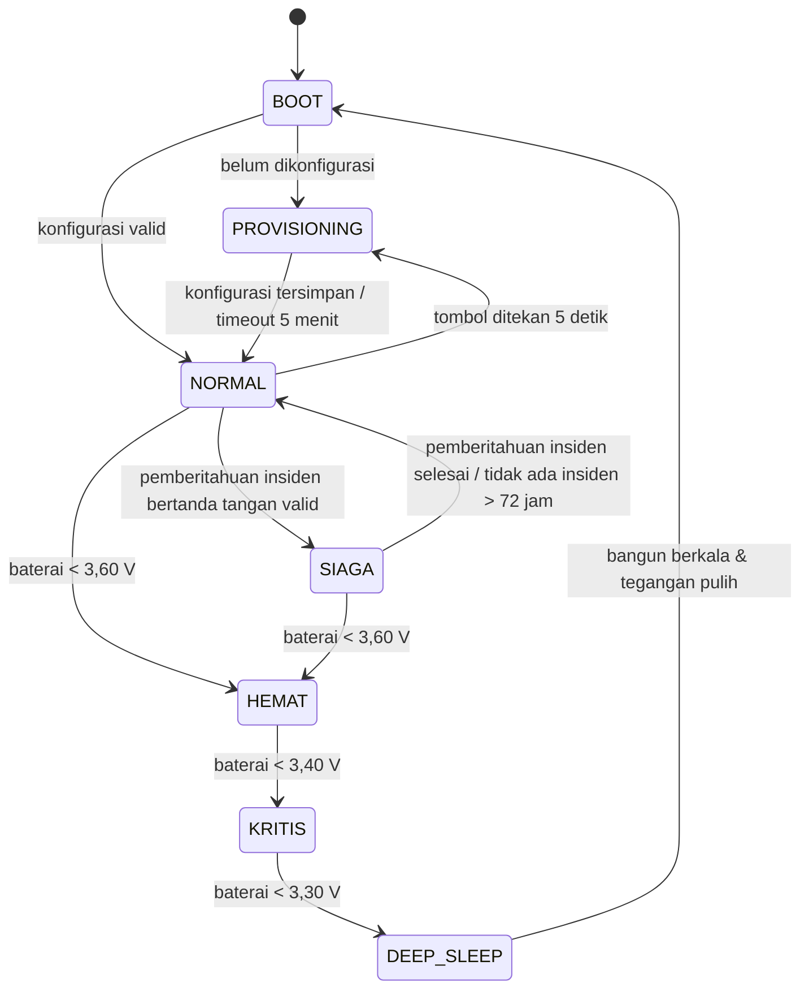

# Hardware Requirements Document (HRD) — WE-IRED Beacon

| Atribut | Keterangan |
|---|---|
| Produk | WE-IRED — komponen **WE-IRED Beacon** |
| Versi dokumen | 0.1 (draf) |
| Tanggal | 23 Oktober 2026 |
| Acuan | [PRD.md](PRD.md) (F-06, F-20, F-22, F-25) · [SRS.md](SRS.md) (FR-BCN, NFR-PWR-02) · [SDD.md](SDD.md) (Bagian 7 & 8) |

---

## 1. Pendahuluan

### 1.1 Apa itu WE-IRED Beacon?

WE-IRED Beacon adalah perangkat kecil bertenaga baterai dan panel surya yang dipasang di setiap **titik kumpul** RT. Beacon menjadi "simpul tetap" jaringan WE-IRED saat sinyal seluler dan internet hilang.

Fungsi beacon:

| Fungsi | Penjelasan | Kebutuhan |
|---|---|---|
| **Kotak surat laporan** | Menerima dan menyimpan paket laporan status dari HP warga dan relawan melalui Bluetooth, termasuk laporan titipan dari HP lain (mesh). | FR-BCN-03 |
| **Check-in titik kumpul** | Memancarkan sinyal Bluetooth. HP warga yang mendekat mendeteksinya dan menawarkan laporan "Sudah di titik kumpul". | FR-BCN-05/06 |
| **Penyiar pengumuman** | Menyimpan pengumuman resmi pengurus (bertanda tangan) dan membagikannya ke setiap HP yang terhubung. | FR-BCN-04 |
| **Jembatan ke Posko** | Terhubung ke Wi-Fi hotspot Posko Lokal dan mengunggah paket yang terkumpul. | FR-BCN-07 |
| **Penanda status di lokasi** | Layar OLED, LED, dan buzzer menunjukkan status siaga, jumlah check-in, dan peringatan darurat. | FR-BCN-11/12 |

### 1.2 Posisi dalam Sistem

```
   [HP Warga] ──BLE──┐
   [HP Warga] ──BLE──┤
   [HP Relawan] ─BLE─┼──► [WE-IRED BEACON] ──Wi-Fi──► [ Posko Lokal ] ──internet──► [ Cloud ]
   (mesh/titipan) ───┘      di titik kumpul           laptop + hotspot
```

Beacon **tidak membutuhkan internet** dan **tidak membaca isi laporan**. Paket laporan ditandatangani oleh rumah masing-masing (HMAC) dan hanya diverifikasi oleh backend. Paket juga tidak memuat nama atau data kesehatan, sehingga beacon yang dicuri tidak membocorkan data pribadi.

---

## 2. Kebutuhan Perangkat Keras

| ID | Kebutuhan |
|---|---|
| HR-01 | Mikrokontroler dengan Bluetooth LE 5 (peripheral + central) dan Wi-Fi 2,4 GHz. |
| HR-02 | Penyimpanan non-volatil untuk minimal 2.000 paket relay (± 120 KB) yang tetap ada setelah daya padam. |
| HR-03 | Jam waktu nyata (RTC) dengan baterai cadangan, dengan akurasi ≤ ±2 menit per bulan. |
| HR-04 | Beroperasi ≥ 72 jam hanya dari baterai dalam mode siaga, tanpa sinar matahari (NFR-PWR-02). |
| HR-05 | Mengisi baterai dari panel surya, dengan proteksi baterai terhadap pengisian berlebih, pengosongan berlebih, dan hubung singkat. |
| HR-06 | Mengukur tegangan baterai dan status pengisian. |
| HR-07 | Layar status yang terbaca di siang hari (OLED 0,96"), 3 LED indikator, dan buzzer. |
| HR-08 | Tombol fisik untuk mematikan buzzer, masuk mode provisioning, dan reset pabrik. |
| HR-09 | Casing tahan cuaca minimal setara IP65, dan dipasang di atas batas banjir tertinggi yang pernah tercatat di lokasi. |
| HR-10 | Jangkauan Bluetooth efektif ≥ 20 m di area terbuka titik kumpul (diukur dengan HP uji). |
| HR-11 | Saklar daya utama yang dapat diakses tanpa membuka segel casing sepenuhnya. |
| HR-12 | Port USB tetap dapat diakses (dengan penutup) untuk pembaruan firmware dan diagnostik. |

---

## 3. Diagram Blok

```
                  ┌───────────────────────┐
  Panel Surya ───►│  Charger Surya CN3791  │
   6V 5W          │  (MPPT, 4,2V)          │
                  └──────────┬────────────┘
                             │  BAT+ / BAT−
                  ┌──────────▼────────────┐
                  │  BMS 1S (DW01+8205)   │◄──── 3× 18650 paralel (1S3P)
                  └──────────┬────────────┘
                             │  P+ / P−
                        [Saklar ON/OFF]
                             │
                  ┌──────────▼────────────┐
                  │ Buck-Boost 3,3V       │
                  │ (TPS63020)            │
                  └──────────┬────────────┘
                             │ 3V3
        ┌────────────────────┼─────────────────────────────┐
        │                    │                             │
 ┌──────▼──────┐     ┌───────▼─────────┐            ┌──────▼───────┐
 │ RTC DS3231  │◄I2C►│   ESP32-S3      │◄──I2C─────►│ OLED SSD1306 │
 └─────────────┘     │ DevKitC-1 N8R8  │            └──────────────┘
                     │  BLE 5 + Wi-Fi  │
   Pembagi tegangan─►│ ADC (GPIO4)     │──GPIO──► LED Hijau/Kuning/Merah
   baterai           │                 │──GPIO──► Driver NPN ──► Buzzer
   Status charger ──►│ GPIO15/16       │◄─GPIO── Tombol
                     └─────────────────┘
```

---

## 4. Daftar Komponen (Bill of Materials)

Harga adalah **perkiraan kasar** per unit di marketplace Indonesia dan perlu dicek ulang sebelum membeli.

| No | Komponen | Spesifikasi | Jml | Fungsi | Perkiraan harga |
|---|---|---|---|---|---|
| 1 | **ESP32-S3-DevKitC-1 (N8R8)** | ESP32-S3, 8 MB flash, 8 MB PSRAM, BLE 5, Wi-Fi | 1 | Otak beacon | Rp90.000–150.000 |
| 2 | Baterai Li-ion **18650** | ≥ 3.000 mAh, sel asli bermerek | 3 | Sumber daya utama (1S3P ≈ 9.000 mAh) | Rp35.000–70.000 /pcs |
| 3 | Holder baterai 18650 3 slot | Disambung **paralel** | 1 | Dudukan baterai | Rp10.000–20.000 |
| 4 | Modul **BMS 1S** | DW01 + FS8205, ≥ 3 A | 1 | Proteksi baterai | Rp5.000–15.000 |
| 5 | Modul charger surya **CN3791** | Versi input 6 V, MPPT, keluaran 4,2 V | 1 | Mengisi baterai dari panel surya | Rp25.000–45.000 |
| 6 | **Panel surya** | 6 V, 5 W (monocrystalline) | 1 | Sumber pengisian | Rp70.000–130.000 |
| 7 | Modul **buck-boost 3,3 V** | Berbasis TPS63020 (atau setara), ≥ 1 A | 1 | Menstabilkan 3,3 V dari baterai 3,0–4,2 V | Rp30.000–70.000 |
| 8 | Modul **RTC DS3231** | I2C, dengan baterai koin | 1 | Waktu akurat saat offline | Rp20.000–35.000 |
| 9 | Baterai koin CR2032 | — | 1 | Cadangan RTC | Rp5.000 |
| 10 | **OLED SSD1306** | 0,96", 128×64, I2C | 1 | Layar status | Rp25.000–40.000 |
| 11 | Buzzer aktif | 3,3–5 V | 1 | Peringatan darurat | Rp3.000–6.000 |
| 12 | Transistor NPN | S8050 / 2N2222 | 1 | Driver buzzer | Rp1.000 |
| 13 | Dioda 1N4148 | — | 1 | Proteksi flyback buzzer | Rp500 |
| 14 | LED 5 mm | Hijau, kuning, merah | 3 | Indikator | Rp1.500 |
| 15 | Resistor | 220 Ω ×3 (LED), 1 kΩ ×1 (basis NPN), 100 kΩ ×2 (pembagi tegangan), 10 kΩ ×2 (pull-up status charger) | 8 | — | Rp2.000 |
| 16 | Kapasitor | 100 nF ×2 (ADC & dekopling), 470 µF 10 V ×1 (buffer 3V3) | 3 | Stabilitas | Rp2.000 |
| 17 | Push button tahan air | Panel mount 12–16 mm | 1 | Tombol multifungsi | Rp5.000–15.000 |
| 18 | Saklar ON/OFF | Rocker/toggle tahan air | 1 | Daya utama | Rp5.000–15.000 |
| 19 | **Kotak panel IP65** | ABS ± 150×100×70 mm, warna terang | 1 | Casing | Rp30.000–60.000 |
| 20 | Cable gland | PG7 | 2 | Kabel panel surya & cadangan | Rp5.000 |
| 21 | PCB prototipe, header, kabel, terminal sekrup | 7×9 cm | 1 set | Perakitan | Rp20.000–30.000 |
| 22 | Bracket/klem tiang, sekrup, cable ties | — | 1 set | Pemasangan | Rp15.000–30.000 |
| | **Total perkiraan per unit** | | | | **± Rp450.000–850.000** |

**Alternatif & opsional:**
- **ESP32-S3-DevKitC-1U** dengan antena eksternal 2,4 GHz (konektor U.FL, 3–5 dBi) untuk jangkauan lebih baik dari dalam casing.
- Modul microSD (SPI) untuk log jangka panjang.
- Termistor NTC 10 kΩ di dekat baterai untuk pemantauan suhu.

---

## 5. Wiring (Pengkabelan)

### 5.1 Tabel Pin ESP32-S3-DevKitC-1

| Fungsi | Pin ESP32-S3 | Terhubung ke | Catatan |
|---|---|---|---|
| Daya 3,3 V | **3V3** | OUT+ buck-boost, VCC DS3231, VCC OLED | Lihat 5.3 tentang USB |
| Ground | **GND** | OUT− buck-boost, GND semua modul | Ground bersama |
| I2C SDA | **GPIO8** | SDA DS3231, SDA OLED | Pull-up sudah ada di modul |
| I2C SCL | **GPIO9** | SCL DS3231, SCL OLED | Alamat: DS3231 `0x68`, OLED `0x3C` |
| ADC baterai | **GPIO4** (ADC1_CH3) | Titik tengah pembagi 100 kΩ/100 kΩ | Memakai ADC1 karena ADC2 bentrok dengan Wi-Fi |
| Status mengisi | **GPIO15** | Pin CHRG CN3791 (open-drain) | Pull-up 10 kΩ ke 3V3; LOW = sedang mengisi |
| Status penuh | **GPIO16** | Pin DONE CN3791 (open-drain) | Pull-up 10 kΩ ke 3V3; LOW = penuh |
| LED hijau | **GPIO5** | Anoda LED → katoda via 220 Ω ke GND | |
| LED kuning | **GPIO6** | Idem | |
| LED merah | **GPIO7** | Idem | |
| Buzzer | **GPIO17** | Basis NPN melalui 1 kΩ | Lihat 5.4 |
| Tombol | **GPIO18** | Tombol → GND | Pull-up internal |

**Pin yang dihindari:**
- GPIO0, 3, 45, 46 adalah pin *strapping* yang memengaruhi proses boot.
- GPIO19/20 dipakai USB.
- GPIO26–32 dipakai flash.
- GPIO33–37 dipakai PSRAM octal pada varian N8R8.
- GPIO38/48 dipakai LED RGB bawaan (tergantung revisi board).

### 5.2 Jalur Daya

```
Panel Surya (+) ──────────────► CN3791 IN+
Panel Surya (−) ──────────────► CN3791 IN−

CN3791 BAT+ ──────────────────► BMS B+ ──── (+) 3× 18650 paralel
CN3791 BAT− ──────────────────► BMS B− ──── (−) 3× 18650 paralel

BMS P+ ──► Saklar ON/OFF ──► Buck-Boost VIN+
BMS P− ───────────────────► Buck-Boost VIN−

Buck-Boost VOUT+ (3,3 V) ──► ESP32 3V3  (+ kapasitor 470 µF ke GND)
Buck-Boost VOUT− ──────────► ESP32 GND

Pembagi tegangan baterai (setelah saklar):
BMS P+ ──[100 kΩ]──┬──[100 kΩ]── GND
                   │
                   ├──[100 nF]── GND
                   └──────────► GPIO4
```

> Dengan baterai penuh 4,2 V, tegangan di GPIO4 = 2,1 V, masih dalam rentang ADC ESP32-S3 dengan atenuasi 11 dB. Firmware mengalikan hasil ukur dengan 2 dan mengkalibrasinya dengan multimeter (Bagian 10).

### 5.3 Catatan Penting Daya

1. **Baterai dirangkai paralel (1S3P)**, bukan seri. Pastikan ketiga sel memiliki tegangan yang sama (selisih < 0,05 V) sebelum dipasang, untuk menghindari arus besar antar-sel.
2. **CN3791 tidak memiliki proteksi pengosongan berlebih**, sehingga modul BMS 1S wajib dipasang.
3. **Saat flashing lewat USB**, matikan saklar daya utama terlebih dahulu. Menyalakan USB dan catu daya 3V3 eksternal bersamaan dapat membebani regulator onboard.
4. Gunakan kabel minimal 22 AWG untuk jalur baterai dan buck-boost.
5. Beri sekring PTC 2 A (opsional) pada jalur BMS P+.

### 5.4 Driver Buzzer

```
GPIO17 ──[1 kΩ]──► Basis NPN (S8050)
                    Kolektor ──┬──► Buzzer (−)
                               └──[1N4148, katoda ke 3V3]
                    Emitor ─────► GND
3V3 ────────────────────────────► Buzzer (+)
```

### 5.5 LED Indikator

```
GPIO5 ──► LED Hijau  (anoda) ──(katoda)──[220 Ω]──► GND
GPIO6 ──► LED Kuning (anoda) ──(katoda)──[220 Ω]──► GND
GPIO7 ──► LED Merah  (anoda) ──(katoda)──[220 Ω]──► GND
```

### 5.6 Tata Letak di Dalam Casing

- Baterai dan BMS diletakkan di bagian bawah casing, terpisah dari ESP32 dan dialasi bahan tahan panas.
- ESP32 diletakkan di bagian atas, dengan **antena PCB tidak tertutup logam atau kabel**, menghadap sisi casing yang paling terbuka.
- OLED dan LED dipasang di balik jendela akrilik bening yang dilem silikon.
- Kabel panel surya masuk melalui cable gland di **sisi bawah** casing untuk mencegah air masuk.
- Tambahkan sachet silica gel di dalam casing.

---

## 6. Anggaran Daya

Angka berikut adalah **estimasi desain** dan wajib diverifikasi dengan pengukuran (Bagian 10).

| Kondisi | Komponen aktif | Arus rata-rata (estimasi) |
|---|---|---|
| **Normal** (tidak ada insiden) | BLE advertising interval 1 s, Wi-Fi mati (sinkron tiap 10 menit jika Posko ada), OLED mati | ± 25 mA |
| **Siaga** | BLE advertising 100–200 ms + koneksi, Wi-Fi tersambung (modem sleep), sinkron tiap 30 s, OLED redup tiap 10 s | ± 70 mA |
| **Siaga + buzzer** | Buzzer aktif beberapa detik per menit | + 5 mA rata-rata |

**Kapasitas efektif baterai:** 3 × 3.000 mAh × 85% (kedalaman pengosongan aman) × 90% (efisiensi buck-boost) ≈ **6.885 mAh**.

| Mode | Ketahanan tanpa matahari |
|---|---|
| Siaga (70 mA) | ± **98 jam** (≥ 72 jam ✔) |
| Normal (25 mA) | ± **275 jam** (± 11 hari) |

**Pengisian surya:** panel 5 W × ± 4 jam matahari efektif × 70% efisiensi ≈ 14 Wh/hari ≈ 3.780 mAh pada 3,7 V. Ini melebihi konsumsi siaga per hari (± 1.680 mAh). Saat hujan atau mendung, yang sering terjadi saat banjir, keluaran panel dapat turun ke 10–25%, sehingga **baterai menjadi cadangan utama**.

**Ambang baterai di firmware:**

| Tegangan | Tindakan |
|---|---|
| ≥ 3,60 V | Normal |
| 3,40–3,60 V | Mode hemat: advertising 500 ms, sinkron 60 s, OLED hanya saat tombol ditekan |
| 3,30–3,40 V | Kritis: Wi-Fi hanya untuk sinkron tiap 5 menit, buzzer nonaktif, LED merah berkedip |
| < 3,30 V | Simpan data, kirim telemetri terakhir, lalu deep sleep. Bangun tiap 10 menit untuk cek tegangan |

---

## 7. Firmware

### 7.1 Arsitektur

Firmware ditulis dengan PlatformIO + Arduino-ESP32, menggunakan tugas FreeRTOS terpisah:

| Modul | Tanggung jawab |
|---|---|
| `main` / `StateMachine` | Mengelola mode: BOOT → PROVISIONING / NORMAL ↔ SIAGA, serta HEMAT/KRITIS |
| `BleServer` (NimBLE) | Layanan WE-IRED Beacon: `NODE_INFO`, `LUV`, `INBOX`, `OUTBOX`, `ANNOUNCE`, `BEACON_PROVISION`, `BEACON_STATUS` (UUID di SDD 7.1) |
| `PacketStore` | Penyimpanan paket di LittleFS, deduplikasi berdasarkan kunci `(household_short_id, incident_short_id, seq)` |
| `WifiSync` | Koneksi ke hotspot Posko, `POST /api/v1/beacon/sync` bertanda tangan HMAC (SDD 8.4) |
| `AnnounceStore` | Verifikasi Ed25519 dan penyimpanan pengumuman & pemberitahuan insiden |
| `PowerMonitor` | Membaca ADC baterai dan status charger, lalu menentukan mode daya |
| `TimeKeeper` | DS3231 + sinkron waktu dari respons Posko |
| `Display` | OLED SSD1306 (U8g2) |
| `Indicator` | Pola LED & buzzer |
| `Button` | Deteksi tekan singkat, 5 detik, dan 15 detik |

### 7.2 Mesin Status



**Masuk mode SIAGA:** beacon menerima *pemberitahuan insiden* bertanda tangan server (tipe paket `0x11`, format sama dengan pengumuman di SDD 7.6) dari respons sinkron Posko atau dari HP relawan melalui karakteristik `ANNOUNCE`. Paket laporan biasa dari warga **tidak** dapat memicu mode siaga, sehingga beacon tidak bisa dipalsukan untuk "berbunyi".

### 7.3 Penyimpanan (LittleFS)

```
/config.bin        konfigurasi provisioning (terenkripsi dengan kunci turunan eFuse chip)
/ann/latest.bin    pengumuman & pemberitahuan insiden terbaru
/pk/seg_0000.bin   segmen paket (64 paket per segmen, ditulis append)
/pk/seg_0001.bin
/pk/acked.bin      daftar kunci paket yang sudah di-ACK Posko
/log/telemetry.bin ring buffer telemetri 24 jam
```

- Kapasitas target **5.000 paket** (± 300 KB), melebihi kebutuhan minimal 2.000 paket (FR-BCN-03).
- Saat boot, indeks paket dibangun ulang di RAM/PSRAM dari segmen.
- Segmen yang seluruh paketnya sudah di-ACK atau berumur > 72 jam dihapus (FR-BCN-10).
- Jika penyimpanan penuh, paket tertua yang sudah di-ACK dihapus lebih dulu, lalu paket tertua dengan status selain "butuh bantuan".

### 7.4 Provisioning

1. Pengurus mendaftarkan beacon di Dashboard (ID perangkat ditampilkan di OLED saat mode provisioning).
2. Dashboard membuat token provisioning sekali pakai. Aplikasi Relawan memakai token itu untuk mengambil **paket konfigurasi** dari backend.
3. Di lokasi, tombol beacon ditekan 5 detik hingga ketiga LED berkedip bergantian. Mode ini adalah **bukti kehadiran fisik**: konfigurasi hanya dapat ditulis dalam mode ini.
4. Aplikasi Relawan terhubung ke beacon dan menulis paket konfigurasi ke `BEACON_PROVISION`:

| Field | Keterangan |
|---|---|
| `beacon_id` | UUID beacon |
| `rt_short_id`, `assembly_point_short_id` | Untuk data iklan |
| `beacon_secret` | 32 byte untuk HMAC sinkron |
| `server_pubkey` | Kunci publik Ed25519 untuk verifikasi pengumuman |
| `posko_ssid`, `posko_pass` | Wi-Fi hotspot Posko |
| `posko_host`, `posko_port` | Contoh: `weired-posko.local:8080` |
| `rssi_threshold` | Ambang check-in hasil kalibrasi |

5. Beacon menyimpan konfigurasi, berbunyi dua kali, lalu masuk mode NORMAL.

Tekan tombol 15 detik untuk **reset pabrik**: konfigurasi dan paket dihapus.

### 7.5 Pola Indikator

| Kondisi | LED | Buzzer |
|---|---|---|
| Normal | Hijau berkedip 1× tiap 5 detik | — |
| Siaga | Hijau + kuning berkedip bergantian tiap 1 detik | — |
| Siaga, Posko tidak terhubung > 2 menit | Kuning menyala tetap | — |
| Check-in diterima | Hijau menyala 1 detik | Bip pendek 1× (dapat dimatikan) |
| Pengumuman **darurat** diterima | Merah berkedip cepat | 3 bip panjang, diulang tiap 60 detik hingga tombol ditekan (maks. 10 menit) |
| Baterai rendah (HEMAT/KRITIS) | Merah berkedip 1× tiap 10 detik | — |
| Penyimpanan penuh / galat | Merah menyala tetap | — |
| Provisioning | Ketiga LED berkedip bergantian | Bip 2× saat berhasil |

**Tombol:** tekan singkat = matikan buzzer & nyalakan OLED 60 detik · tekan 5 detik = provisioning · tekan 15 detik = reset pabrik.

### 7.6 Tampilan OLED

```
┌────────────────────────────┐
│ WE-IRED · TK Balai RW 03  │
│ ■ SIAGA BANJIR             │
│ Check-in: 23  Paket: 57    │
│ Bat 78% ☀  Posko OK 12d    │
└────────────────────────────┘
```

OLED mati otomatis 60 detik setelah tombol ditekan. Dalam mode siaga, OLED menyala redup dan diperbarui tiap 10 detik (dapat dinonaktifkan untuk menghemat daya).

### 7.7 Data Iklan BLE

Sesuai SDD 7.1: `jenis_node = 3`, `rt_short_id`, `incident_short_id` (0 jika normal), `announce_version`, `flags`. Scan response berisi `assembly_point_short_id` dan nama pendek "WEIRED-XXXX".

| Mode | Interval advertising |
|---|---|
| Normal | 1.000 ms |
| Siaga | 100–200 ms (agar check-in cepat terdeteksi) |
| Hemat | 500 ms |

---

## 8. Ketentuan Pemasangan

| Aspek | Ketentuan |
|---|---|
| Ketinggian | **Di atas batas banjir tertinggi yang pernah tercatat** di lokasi, minimal 2,5 m dari tanah, agar tidak terendam dan sulit dijangkau tangan |
| Lokasi | Di tengah area titik kumpul, tanpa penghalang logam atau beton tebal di sekitar antena |
| Panel surya | Menghadap utara (untuk lokasi di selatan khatulistiwa seperti Jawa) dengan kemiringan 10–15°, bebas bayangan pohon/bangunan pada jam 09.00–15.00 |
| Casing | Warna terang, dan sebisa mungkin terlindung dari sinar matahari langsung agar suhu baterai tetap rendah |
| Pengamanan | Klem tiang dan sekrup anti-maling. Beri label "Perangkat WE-IRED — hubungi Ketua RT" beserta nomor kontak |
| Jarak ke Posko | Dalam jangkauan Wi-Fi hotspot Posko, atau Posko menyediakan router portabel/repeater di dekat titik kumpul |

---

## 9. Kalibrasi Check-in (RSSI)

Kalibrasi menentukan ambang `rssi_threshold` agar check-in hanya ditawarkan kepada warga yang benar-benar berada di area titik kumpul.

1. Tandai batas area titik kumpul, misalnya radius 15 m dari beacon.
2. Siapkan minimal 3 HP Android berbeda (merek/kelas berbeda) dengan Aplikasi Relawan dalam mode diagnostik beacon.
3. Catat RSSI rata-rata (30 detik) pada jarak 5 m, 10 m, 15 m, dan 25 m. Lakukan di beberapa arah, dengan HP di tangan maupun di saku.
4. Tetapkan ambang = RSSI rata-rata di jarak 15 m (batas area) dikurangi margin 3 dB, lalu dibulatkan. Jika tidak dikalibrasi, ambang bawaan adalah −75 dBm.
5. Simpan ambang di Dashboard (data beacon). Ambang dikirim ke beacon saat provisioning dan ke Aplikasi Warga melalui snapshot.
6. Uji ulang: dari 10 percobaan masuk area, check-in harus ditawarkan ≥ 9 kali. Dari 10 percobaan di jarak 30 m, check-in tidak boleh ditawarkan lebih dari 1 kali.

---

## 10. Pengujian Perangkat Keras

| ID | Uji | Prosedur | Kriteria lulus |
|---|---|---|---|
| HT-01 | Kalibrasi ADC | Bandingkan pembacaan firmware dengan multimeter pada 3,3 V, 3,7 V, dan 4,2 V | Selisih ≤ 0,05 V setelah faktor kalibrasi |
| HT-02 | Ketahanan baterai | Mode siaga terus-menerus, panel dilepas, baterai penuh | ≥ 72 jam sampai mode KRITIS (HR-04) |
| HT-03 | Pengisian surya | Panel terpasang di luar ruangan 1 hari cerah | Baterai naik dari 50% ke ≥ 90% |
| HT-04 | Jangkauan BLE | Ukur jarak maksimal koneksi dan pertukaran paket dengan 3 HP di area terbuka | Pertukaran berhasil ≥ 20 m (HR-10) |
| HT-05 | Kapasitas penyimpanan | Kirim 5.000 paket sintetis, lalu matikan dan nyalakan daya | Seluruh paket tetap ada dan tanpa duplikat |
| HT-06 | Sinkron Posko | Beacon dengan 500 paket terhubung ke Posko | Semua paket diterima backend, di-ACK, dan dihapus dari beacon |
| HT-07 | Pemulihan daya | Cabut-pasang baterai saat menulis paket (20×) | Tidak ada korupsi berkas; beacon kembali beroperasi otomatis |
| HT-08 | Tahan air | Semprot air dari berbagai arah selama 3 menit (simulasi hujan deras) | Tidak ada air di dalam casing |
| HT-09 | Suhu | Casing dijemur 4 jam di siang hari, suhu dalam diukur | Suhu baterai ≤ 45 °C saat mengisi. Jika melebihi, tambah peneduh/ventilasi |
| HT-10 | Keamanan paket | Tangkap lalu lintas BLE dengan sniffer/aplikasi nRF Connect | Tidak ada nama, nomor telepon, atau data kesehatan (AC-10) |
| HT-11 | Anti-pemalsuan siaga | Kirim pemberitahuan insiden dengan tanda tangan salah | Beacon menolak dan tidak masuk mode SIAGA |
| HT-12 | Kalibrasi RSSI | Prosedur Bagian 9 | Memenuhi kriteria langkah 6 |

---

## 11. Keselamatan & Perawatan

**Keselamatan baterai Li-ion:**
- Gunakan sel 18650 asli dari sumber terpercaya. Jangan memakai sel bekas yang kapasitasnya tidak jelas.
- Jangan mengisi baterai di atas 45 °C. Jauhkan casing dari sumber panas.
- Baterai yang menggembung, panas tidak wajar, atau berbau harus segera dilepas dan dibuang sesuai ketentuan limbah B3.
- Jangan menghubungkan sel dengan tegangan berbeda secara paralel.

**Jadwal perawatan:**

| Interval | Kegiatan |
|---|---|
| Bulanan | Cek telemetri di Dashboard (baterai, sinkron terakhir), bersihkan panel surya |
| Setiap latihan evakuasi | Uji check-in, buzzer, dan sinkron Posko |
| 6 bulan | Buka casing: cek kelembapan, ganti silica gel, cek kekencangan terminal |
| 2–3 tahun | Ganti baterai 18650 dan CR2032 |

---

## 12. Pengembangan Lanjutan

- **LoRa (SX1262, 920–923 MHz, sesuai regulasi frekuensi Indonesia):** menghubungkan beacon antar-titik kumpul atau ke Posko yang jauh tanpa Wi-Fi.
- **PCB khusus:** mengganti DevKit + modul dengan satu PCB agar lebih ringkas, murah, dan andal.
- **Sensor ketinggian air** (ultrasonik/float switch) di titik rawan, dengan data ditampilkan di Dashboard sebagai informasi pendukung.
- **Pembaruan firmware OTA** melalui Posko Lokal, dengan firmware bertanda tangan.
