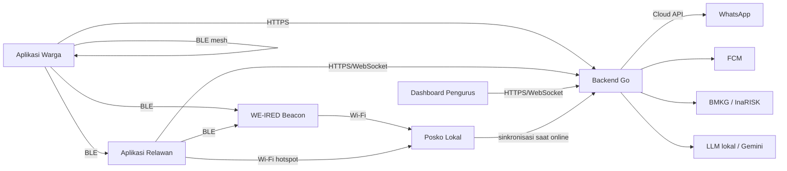

# Software Requirements Specification (SRS) — WE-IRED

| Atribut | Keterangan |
|---|---|
| Produk | WE-IRED |
| Versi dokumen | 0.1 (draf) |
| Tanggal | 23 Oktober 2026 |
| Acuan | [PRD.md](PRD.md) (daftar fitur F-01 s.d. F-30) |
| Dokumen terkait | [SDD.md](SDD.md) · [HRD.md](HRD.md) |

---

## 1. Pendahuluan

### 1.1 Tujuan Dokumen

Dokumen ini mendefinisikan kebutuhan perangkat lunak WE-IRED secara terukur dan dapat diuji. Setiap kebutuhan diberi ID unik agar dapat ditelusuri ke fitur di PRD dan ke desain di SDD.

### 1.2 Lingkup

WE-IRED mencakup Aplikasi Warga, Aplikasi Relawan, Dashboard Pengurus, Backend (cloud dan Posko Lokal), firmware WE-IRED Beacon, serta integrasi WhatsApp Cloud API, FCM, BMKG, InaRISK, dan layanan AI.

### 1.3 Konvensi

- **FR-[MODUL]-nn**: kebutuhan fungsional.
- **NFR-[KATEGORI]-nn**: kebutuhan non-fungsional.
- Kata **"harus"** menandakan kebutuhan wajib. Seluruh kebutuhan dalam dokumen ini berprioritas **Wajib**.
- Kolom **Fitur** merujuk ke ID fitur di PRD.

### 1.4 Istilah

| Istilah | Arti |
|---|---|
| Rumah / KK | Satu unit kepala keluarga yang menjadi unit laporan status. |
| Warga rentan | Anggota keluarga dengan kategori lansia (≥ 60 tahun), penyandang disabilitas, ibu hamil, balita (< 5 tahun), atau penyakit kronis. |
| Insiden | Satu sesi mode siaga (nyata atau latihan) dari aktivasi sampai diakhiri. |
| Outbox | Antrean lokal di perangkat berisi aksi yang belum terkirim ke server. |
| Paket relay | Laporan status dalam format biner ringkas yang ditandatangani dan dapat diteruskan melalui Bluetooth. |
| LUV | *Latest Update Vector*, katalog ID rumah beserta nomor urut laporan terbaru yang diketahui sebuah node. |
| Data mule | Perangkat bergerak (HP relawan) yang mengumpulkan paket relay lalu meneruskannya. |
| Posko Lokal | Instance backend yang berjalan di laptop posko dan melayani jaringan lokal (hotspot) saat internet terputus. |
| WE-IRED Beacon | Perangkat ESP32 statis di titik kumpul (lihat HRD). |

---

## 2. Deskripsi Umum

### 2.1 Perspektif Produk

### 2.2 Kelas Pengguna

| Kelas | Hak akses ringkas |
|---|---|
| Operator Sistem | Mengelola wilayah (kelurahan, RW, RT) dan akun Pengurus/Admin Wilayah. Tidak melihat data kerentanan detail. |
| Admin Wilayah | Melihat agregat lintas RT dalam wilayahnya, menerima rekap. |
| Pengurus RT | Akses penuh ke data RT-nya. |
| Relawan | Melihat rumah di blok yang ditugaskan (termasuk kerentanan), melapor atas nama warga, mengelola tugas. |
| Kepala Keluarga | Melihat dan mengubah data rumahnya sendiri, melapor status, mengakses edukasi. |
| Warga via WhatsApp | Menerima notifikasi dan melapor melalui tombol balasan tanpa akun aplikasi. |

### 2.3 Lingkungan Operasi

| Komponen | Lingkungan |
|---|---|
| Aplikasi Warga & Relawan | Android 8.0 (API 26) atau lebih baru, Bluetooth LE dengan dukungan peran peripheral untuk fitur mesh. |
| Dashboard Pengurus | Peramban modern (Chrome, Edge, Firefox versi terbaru) dan build desktop Windows. |
| Backend cloud | Linux (VPS) dengan Docker; PostgreSQL 16. |
| Posko Lokal | Laptop Windows/Linux dengan Docker, Wi-Fi hotspot. |
| WE-IRED Beacon | ESP32-S3 (lihat HRD). |

### 2.4 Batasan Desain

- Aplikasi mobile dibangun dengan Flutter; backend dengan Go; basis data PostgreSQL.
- WhatsApp hanya melalui **WhatsApp Cloud API resmi**. Library tidak resmi dilarang.
- Seluruh kode dibangun baru untuk STACK 2026.
- Kredensial (token WhatsApp, kunci FCM, kunci Gemini, rahasia JWT) tidak boleh berada di repositori.
- Paket Bluetooth/mesh/beacon tidak boleh memuat data pribadi spesifik.

### 2.5 Asumsi

- Waktu perangkat warga dapat tidak akurat; server dan beacon menggunakan sumber waktu sendiri untuk pengurutan.
- Satu RT berisi hingga 300 rumah dan 1.200 warga.
- Pengurus telah mengunduh snapshot data RT ke Posko Lokal sebelum kejadian.

---

## 3. Kebutuhan Fungsional

### 3.1 Autentikasi & Manajemen Akun (AUTH)

| ID | Kebutuhan | Fitur |
|---|---|---|
| FR-AUTH-01 | Sistem harus mendukung login dengan nomor HP dan OTP 6 digit yang dikirim melalui template autentikasi WhatsApp. | F-30 |
| FR-AUTH-02 | Dashboard harus mendukung login alternatif dengan email dan kata sandi untuk Pengurus, Admin Wilayah, dan Operator. | — |
| FR-AUTH-03 | Kepala keluarga harus mengaktifkan akun dengan memasukkan kode undangan rumah (8 karakter) yang dibuat Pengurus, lalu memverifikasi OTP. | F-01 |
| FR-AUTH-04 | Sistem harus menerapkan kontrol akses berbasis peran sesuai Bagian 2.2 pada setiap endpoint API. | — |
| FR-AUTH-05 | Sistem harus menerbitkan access token (masa berlaku 15 menit) dan refresh token (masa berlaku 30 hari) yang dapat dicabut. | — |
| FR-AUTH-06 | Aplikasi harus tetap dapat membuat laporan saat offline menggunakan sesi terakhir yang tersimpan. | F-17 |
| FR-AUTH-07 | Saat akun rumah diaktifkan, sistem harus membuat kunci rumah (household key) yang disimpan aman di perangkat untuk menandatangani paket relay. | F-18, F-19 |
| FR-AUTH-08 | OTP harus kedaluwarsa dalam 5 menit dan dibatasi maksimal 5 percobaan per 15 menit per nomor. | — |

### 3.2 Pendataan Rumah & Warga (HH)

| ID | Kebutuhan | Fitur |
|---|---|---|
| FR-HH-01 | Pengurus harus dapat membuat, mengubah, dan menonaktifkan data rumah: nomor rumah, alamat, blok, koordinat (dipilih di peta), nama kepala keluarga, dan nomor WhatsApp. | F-01 |
| FR-HH-02 | Pengurus dan Kepala Keluarga harus dapat menambah anggota keluarga: nama, tahun lahir, jenis kelamin, hubungan, dan kategori kerentanan (multi-pilih). | F-01 |
| FR-HH-03 | Sistem harus menandai anggota sebagai lansia atau balita secara otomatis dari tahun lahir, dan dapat dikoreksi manual. | F-01 |
| FR-HH-04 | Data kerentanan dan catatan kesehatan hanya boleh disimpan setelah persetujuan dicatat (siapa yang menyetujui, waktu, versi teks persetujuan, metode: aplikasi/kertas/lisan disaksikan). | F-01 |
| FR-HH-05 | Kepala Keluarga harus dapat mencabut persetujuan; sistem harus menghapus data kerentanan detail dalam 24 jam dan hanya menyimpan penanda "membutuhkan bantuan evakuasi" jika warga mengizinkan. | F-01 |
| FR-HH-06 | Sistem harus menyediakan impor data rumah dari berkas CSV dengan validasi per baris dan laporan kesalahan. | F-01 |
| FR-HH-07 | Sistem harus membuat kode undangan unik per rumah dan dapat mengirimkannya melalui WhatsApp. | F-01, F-30 |
| FR-HH-08 | Sistem harus menandai rumah tanpa HP/WhatsApp sebagai "perlu dijangkau relawan". | F-09 |

### 3.3 Titik Kumpul (AP)

| ID | Kebutuhan | Fitur |
|---|---|---|
| FR-AP-01 | Pengurus harus dapat membuat, mengubah, dan menonaktifkan titik kumpul: nama, koordinat, kapasitas, fasilitas (aksesibel kursi roda, toilet, listrik, air), dan kontak penanggung jawab. | F-02 |
| FR-AP-02 | Setiap blok harus dapat dikaitkan dengan titik kumpul utama dan cadangan. | F-02 |
| FR-AP-03 | Sistem harus menampilkan jumlah warga yang sudah check-in di setiap titik kumpul selama insiden. | F-02, F-22 |

### 3.4 Relawan & Blok (VOL)

| ID | Kebutuhan | Fitur |
|---|---|---|
| FR-VOL-01 | Pengurus harus dapat membuat blok dan menentukan rumah yang termasuk di dalamnya. | F-03 |
| FR-VOL-02 | Pengurus harus dapat mendaftarkan relawan (nama, nomor WhatsApp, keahlian: P3K, evakuasi, logistik) dan menugaskan relawan ke satu atau lebih blok. | F-03 |
| FR-VOL-03 | Relawan harus dapat mengatur status ketersediaan (siap / tidak tersedia). | F-03 |
| FR-VOL-04 | Relawan hanya dapat melihat detail kerentanan rumah di blok yang ditugaskan kepadanya atau rumah yang ditugaskan langsung. | F-03, F-14 |

### 3.5 Edukasi Kesiapsiagaan (EDU)

| ID | Kebutuhan | Fitur |
|---|---|---|
| FR-EDU-01 | Aplikasi Warga harus menyediakan modul edukasi per jenis bencana (minimal banjir, tanah longsor, gempa bumi, kebakaran) yang dapat diakses offline setelah diunduh. | F-04 |
| FR-EDU-02 | Setiap modul harus memiliki kuis pilihan ganda dengan umpan balik penjelasan untuk setiap jawaban. | F-04 |
| FR-EDU-03 | Aplikasi Warga harus menyediakan checklist tas siaga yang dapat dicentang per item. | F-04 |
| FR-EDU-04 | Kepala Keluarga harus dapat menyusun rencana evakuasi keluarga: titik kumpul yang dituju, penanggung jawab tiap anggota rentan, kontak darurat, dan lokasi dokumen penting. | F-04 |
| FR-EDU-05 | Sistem harus menghitung skor kesiapsiagaan rumah (0–100): modul selesai 30%, nilai kuis 30%, checklist tas siaga 20%, rencana evakuasi lengkap 20%. | F-04 |
| FR-EDU-06 | Dashboard harus menampilkan skor kesiapsiagaan per rumah, rata-rata per blok, dan tren dari waktu ke waktu. | F-04 |
| FR-EDU-07 | Pengurus harus dapat mengelola konten modul dan kuis (tambah, ubah, terbitkan). | F-04 |
| FR-EDU-08 | Rencana evakuasi keluarga harus dapat dilihat di Aplikasi Warga tanpa internet. | F-04, F-17 |

### 3.6 Insiden: Mode Siaga & Mode Latihan (INC)

| ID | Kebutuhan | Fitur |
|---|---|---|
| FR-INC-01 | Pengurus harus dapat mengaktifkan insiden dengan memilih jenis bencana, mode (nyata/latihan), cakupan (seluruh RT atau blok tertentu), dan pesan awal. | F-05, F-07 |
| FR-INC-02 | Aktivasi insiden harus meminta konfirmasi dua langkah untuk mode nyata. | F-07 |
| FR-INC-03 | Saat insiden aktif, sistem harus mengirim push notification ke Aplikasi Warga dan Relawan serta pesan template WhatsApp ke kepala keluarga dalam cakupan dalam 60 detik. | F-07, F-30 |
| FR-INC-04 | Insiden mode latihan harus ditandai "LATIHAN" pada setiap layar, notifikasi, pesan WhatsApp, dan rekap. | F-05 |
| FR-INC-05 | Hanya satu insiden nyata yang boleh aktif per RT pada satu waktu. Insiden latihan tidak boleh dimulai saat insiden nyata aktif. | F-05, F-07 |
| FR-INC-06 | Pengurus harus dapat mengakhiri insiden; sistem harus menyimpan waktu mulai dan selesai. | F-07 |
| FR-INC-07 | Sistem harus menghitung metrik insiden: waktu sampai 90% dan 100% rumah melapor, persentase rumah rentan terjangkau dalam 30 menit, jumlah laporan per kanal, dan waktu penyusunan rekap. | F-05 |
| FR-INC-08 | Sistem harus menyimpan riwayat insiden dan menampilkan perbandingan metrik antar-latihan. | F-05 |

### 3.7 Laporan Status (RPT)

| ID | Kebutuhan | Fitur |
|---|---|---|
| FR-RPT-01 | Saat insiden aktif, Aplikasi Warga harus menampilkan layar lapor dengan tiga tombol besar: **Aman di rumah**, **Sudah di titik kumpul**, **Butuh bantuan**. | F-08 |
| FR-RPT-02 | Jika memilih "Butuh bantuan", warga harus dapat memilih tingkat urgensi (biasa / kritis), jenis kebutuhan (evakuasi, medis, makanan & air, tempat tinggal, lainnya; multi-pilih), anggota keluarga yang butuh bantuan, dan pesan singkat (maks. 140 karakter). | F-08 |
| FR-RPT-03 | Laporan dasar harus dapat dikirim dalam maksimal tiga ketukan dari notifikasi. | F-08 |
| FR-RPT-04 | Setiap laporan harus memuat ID laporan unik (UUID dibuat di perangkat), ID rumah, nomor urut per rumah, waktu perangkat, status, dan kanal. Koordinat GPS dan level baterai dilampirkan jika tersedia. | F-08 |
| FR-RPT-05 | Sistem harus menerima laporan dari kanal: aplikasi (online), outbox, relay relawan, mesh, beacon, check-in beacon, WhatsApp, dan relawan atas nama warga. | F-08, F-09, F-17–F-22, F-30 |
| FR-RPT-06 | Sistem harus menetapkan status terkini rumah dari laporan dengan nomor urut tertinggi; jika nomor urut sama, yang memiliki waktu terima server paling awal dipakai. Laporan "Butuh bantuan" kritis tidak boleh tertimpa laporan otomatis (check-in beacon) tanpa konfirmasi relawan atau warga. | F-08 |
| FR-RPT-07 | Sistem harus menolak secara idempoten laporan dengan ID yang sudah diterima (tanpa membuat duplikat, tetap mengembalikan sukses). | F-17 |
| FR-RPT-08 | Warga harus dapat memperbarui laporannya kapan saja selama insiden aktif. | F-08 |
| FR-RPT-09 | Aplikasi Warga harus menampilkan status pengiriman laporan: terkirim ke server / tersimpan dan menunggu sinyal / diteruskan via relay. | F-17, F-18 |

### 3.8 Laporan oleh Relawan (PRX)

| ID | Kebutuhan | Fitur |
|---|---|---|
| FR-PRX-01 | Relawan harus dapat membuat laporan atas nama rumah di bloknya, dengan kanal "relawan" dan ID relawan pelapor. | F-09 |
| FR-PRX-02 | Relawan harus dapat menandai anggota keluarga tertentu sebagai "sudah aman", "dievakuasi ke titik kumpul X", atau "dirujuk ke fasilitas kesehatan". | F-09, F-14 |
| FR-PRX-03 | Laporan relawan harus dapat dibuat offline dan mengikuti mekanisme outbox. | F-09, F-17 |

### 3.9 Dashboard, Peta & Tabel (DSH)

| ID | Kebutuhan | Fitur |
|---|---|---|
| FR-DSH-01 | Dashboard harus menampilkan ringkasan insiden: jumlah rumah per status (aman, di titik kumpul, butuh bantuan, kritis, belum melapor), jumlah warga rentan belum terjangkau, dan waktu sejak aktivasi. | F-10 |
| FR-DSH-02 | Dashboard harus diperbarui dalam ≤ 3 detik setelah backend menerima laporan, tanpa muat ulang halaman. | F-10 |
| FR-DSH-03 | Dashboard harus menyediakan daftar khusus "Belum Melapor" yang diurutkan berdasarkan skor prioritas. | F-10, F-13 |
| FR-DSH-04 | Peta harus menampilkan pin rumah dengan warna: hijau (aman), biru (di titik kumpul), oranye (butuh bantuan), merah (kritis), abu-abu (belum melapor); serta ikon tambahan untuk rumah dengan warga rentan. | F-11 |
| FR-DSH-05 | Peta harus menampilkan titik kumpul, lingkaran radius (100 m, 250 m, 500 m) dari titik kumpul, posisi dan status beacon, serta posisi terakhir relawan yang membagikan lokasinya. | F-11 |
| FR-DSH-06 | Peta harus dapat berfungsi dengan tile yang telah di-cache untuk wilayah RT saat offline. | F-11 |
| FR-DSH-07 | Tabel triase harus menampilkan rumah, blok, status, urgensi, kebutuhan, jumlah warga rentan, skor prioritas, waktu laporan terakhir, kanal, dan relawan yang ditugaskan. | F-12 |
| FR-DSH-08 | Tabel triase harus dapat diurutkan per kolom dan difilter berdasarkan status, blok, kerentanan, dan kanal. | F-12 |
| FR-DSH-09 | Tombol *Locate* pada tabel harus memusatkan peta ke rumah tersebut dan membuka detailnya. | F-12 |
| FR-DSH-10 | Detail rumah harus menampilkan riwayat laporan selama insiden beserta kanalnya. | F-10 |

### 3.10 Skor Prioritas & Penugasan (PRI, TSK)

| ID | Kebutuhan | Fitur |
|---|---|---|
| FR-PRI-01 | Sistem harus menghitung skor prioritas 0–100 untuk setiap rumah dalam insiden menggunakan rumus di SDD Bagian 6.1 (komponen: status/urgensi, kerentanan, lama menunggu, kebutuhan, jarak). | F-13 |
| FR-PRI-02 | Skor harus dihitung ulang setiap ada laporan baru dan minimal setiap 60 detik. | F-13 |
| FR-PRI-03 | Rumah berstatus "Aman di rumah" tanpa kebutuhan atau "Sudah di titik kumpul" dengan semua anggota terkonfirmasi harus dikeluarkan dari antrean prioritas. | F-13 |
| FR-PRI-04 | Dashboard harus menampilkan rincian komponen skor untuk setiap rumah (transparansi). | F-13 |
| FR-TSK-01 | Sistem harus menyarankan rencana penugasan: memasangkan rumah prioritas tertinggi dengan relawan tersedia di blok yang sama, lalu relawan terdekat dari blok lain. | F-13 |
| FR-TSK-02 | Pengurus harus dapat menyetujui, mengubah, atau membuat penugasan secara manual. | F-14 |
| FR-TSK-03 | Relawan harus menerima notifikasi penugasan dan dapat mengubah status tugas: diterima → dalam perjalanan → dijangkau → selesai, atau ditolak dengan alasan. | F-14 |
| FR-TSK-04 | Saat tugas ditandai "dijangkau", relawan harus mengisi hasil penjangkauan (aman di tempat / dievakuasi / dirujuk / butuh bantuan lanjutan). | F-14 |
| FR-TSK-05 | Tugas yang tidak diterima dalam 5 menit harus ditandai pada dashboard agar dapat dialihkan. | F-14 |

### 3.11 Pengumuman (ANN)

| ID | Kebutuhan | Fitur |
|---|---|---|
| FR-ANN-01 | Pengurus harus dapat membuat pengumuman maksimal 160 karakter dengan tingkat (info / penting / darurat) dan masa berlaku. | F-15 |
| FR-ANN-02 | Pengumuman harus dikirim melalui push notification, WhatsApp (opsional per pengumuman), dan disertakan ke kanal relay (mesh, relawan, beacon). | F-15, F-20, F-30 |
| FR-ANN-03 | Aplikasi Warga harus menampilkan pengumuman aktif sebagai carousel yang bergeser otomatis setiap 6 detik, dengan pengumuman darurat di urutan pertama. | F-15 |
| FR-ANN-04 | Pengumuman harus ditandatangani server sehingga perangkat dapat memverifikasi keasliannya sebelum menampilkan pengumuman yang diterima lewat relay. | F-20 |

### 3.12 Panduan P3K (FA)

| ID | Kebutuhan | Fitur |
|---|---|---|
| FR-FA-01 | Aplikasi Warga dan Relawan harus menyertakan panduan P3K bawaan (tanpa unduhan): RJP/CPR, perdarahan berat, patah tulang, luka bakar, hipotermia, dehidrasi & sengatan panas, dan pertolongan korban tenggelam. | F-16 |
| FR-FA-02 | Setiap panduan harus menampilkan langkah bernomor, tanda bahaya, dan tombol cepat untuk menandai "Butuh bantuan medis". | F-16 |
| FR-FA-03 | Konten panduan harus mencantumkan sumber rujukan resmi dan pernyataan bahwa panduan bukan pengganti tenaga medis. | F-16 |

### 3.13 Offline & Sinkronisasi (SYNC)

| ID | Kebutuhan | Fitur |
|---|---|---|
| FR-SYNC-01 | Aplikasi harus menyimpan seluruh aksi tulis (laporan, update tugas, perubahan data) ke outbox lokal sebelum mencoba mengirim. | F-17 |
| FR-SYNC-02 | Outbox harus dikirim otomatis saat koneksi ke backend (cloud atau Posko Lokal) tersedia, dengan exponential backoff (2 s hingga maks. 5 menit). | F-17 |
| FR-SYNC-03 | Aplikasi harus menyimpan snapshot data yang dibutuhkan secara lokal: data rumah sendiri dan rencana evakuasi (Warga); data blok yang ditugaskan (Relawan). | F-17 |
| FR-SYNC-04 | Aplikasi harus dapat mendeteksi dan beralih otomatis antara backend cloud dan Posko Lokal yang dikonfigurasi. | F-17, F-21 |

### 3.14 Relay Bluetooth & Mesh (BLE)

| ID | Kebutuhan | Fitur |
|---|---|---|
| FR-BLE-01 | Saat insiden aktif dan laporan belum terkirim ke server, Aplikasi Warga harus mengiklankan layanan BLE WE-IRED dan menyediakan paket relay melalui GATT. | F-18 |
| FR-BLE-02 | Aplikasi Relawan harus memindai layanan BLE WE-IRED secara agresif selama insiden aktif, menarik paket relay dari setiap perangkat, dan mengirimkan pengumuman terbaru. | F-18, F-20 |
| FR-BLE-03 | Paket relay harus menggunakan format biner ringkas (lihat SDD Bagian 7) dan tidak boleh memuat nama, nomor telepon, atau data kesehatan. | F-18, F-19 |
| FR-BLE-04 | Setiap paket relay harus ditandatangani dengan HMAC-SHA256 (dipotong 8 byte) menggunakan kunci rumah; backend harus menolak paket dengan tanda tangan tidak valid. | F-18, F-19 |
| FR-BLE-05 | Aplikasi Warga harus menjalankan siklus peran bergantian (advertising/scanning/cooldown) dan bertukar paket dengan HP warga lain menggunakan protokol LUV (lihat SDD Bagian 7.4). | F-19 |
| FR-BLE-06 | Paket mesh harus memiliki batas lompatan (TTL) maksimal 6; node tidak meneruskan paket dengan TTL 0. | F-19 |
| FR-BLE-07 | Setiap node harus menyimpan maksimal 500 paket milik rumah lain; jika penuh, paket tertua dari insiden yang sama dibuang lebih dulu. | F-19 |
| FR-BLE-08 | Paket relay milik rumah lain tidak boleh ditampilkan isinya kepada pengguna Aplikasi Warga. | F-19, F-23 |
| FR-BLE-09 | Aplikasi Relawan dan Dashboard harus menampilkan daftar node di sekitar (ID pendek, RSSI, waktu terakhir terlihat, jumlah paket) dan topologi jalur relay berdasarkan metadata jalur paket. | F-23 |
| FR-BLE-10 | Saat baterai < 20%, siklus BLE harus beralih ke mode hemat (advertising 4 s, scanning 2 s, cooldown 90 s); pada kondisi normal: advertising 8 s, scanning 4 s, cooldown 30 s. | F-24 |
| FR-BLE-11 | Pengguna harus dapat melihat mode baterai yang aktif dan memilih mode hemat secara manual. | F-24 |
| FR-BLE-12 | Paket relay dan pengumuman yang diterima dari perangkat lain harus dihapus otomatis 72 jam setelah waktu pembuatannya atau saat insiden diakhiri dan paket telah terkonfirmasi diterima server. | F-25 |
| FR-BLE-13 | Selama insiden aktif, fungsi BLE harus berjalan sebagai foreground service dengan notifikasi permanen. | F-18, F-19 |

### 3.15 Posko Lokal (PSK)

| ID | Kebutuhan | Fitur |
|---|---|---|
| FR-PSK-01 | Backend harus dapat dijalankan dalam mode `posko` di laptop menggunakan satu perintah Docker Compose. | F-21 |
| FR-PSK-02 | Sebelum kejadian, Posko Lokal harus dapat menarik snapshot data RT dari cloud (rumah, anggota, blok, relawan, titik kumpul, beacon, kunci verifikasi). | F-21 |
| FR-PSK-03 | Posko Lokal harus melayani API yang sama dengan cloud bagi Aplikasi Relawan, Dashboard, dan Beacon dalam jaringan lokal. | F-21 |
| FR-PSK-04 | Aplikasi Relawan harus dapat dikonfigurasi ke Posko Lokal dengan memindai kode QR yang ditampilkan Dashboard Posko. | F-21 |
| FR-PSK-05 | Saat internet tersedia, Posko Lokal harus mengunggah semua laporan, tugas, dan pengumuman ke cloud secara idempoten dan mengunduh perubahan dari cloud. | F-21 |
| FR-PSK-06 | Konflik antara cloud dan Posko Lokal harus diselesaikan dengan aturan yang sama seperti FR-RPT-06; perubahan data master selama offline dicatat untuk ditinjau Pengurus. | F-21 |

### 3.16 WE-IRED Beacon (BCN)

| ID | Kebutuhan | Fitur |
|---|---|---|
| FR-BCN-01 | Pengurus harus dapat mendaftarkan beacon (ID perangkat, titik kumpul, nama) dan melakukan provisioning melalui Aplikasi Relawan via BLE: ID titik kumpul, rahasia beacon, SSID/kata sandi Wi-Fi Posko, alamat Posko. | F-06 |
| FR-BCN-02 | Beacon harus mengiklankan ID beacon, ID titik kumpul, versi pengumuman terbaru, dan status insiden dalam data iklan BLE. | F-22 |
| FR-BCN-03 | Beacon harus menerima dan menyimpan paket relay dari HP warga dan relawan (minimal 2.000 paket) tanpa memverifikasi isinya, dan menyediakannya untuk diambil relawan. | F-22 |
| FR-BCN-04 | Beacon harus menyimpan dan menyiarkan pengumuman terbaru yang diterimanya dari Posko atau relawan, dan hanya menerima pengumuman bertanda tangan server yang valid. | F-20, F-22 |
| FR-BCN-05 | Aplikasi Warga harus mendeteksi beacon titik kumpul dengan RSSI rata-rata ≥ ambang RSSI beacon tersebut (hasil kalibrasi, bawaan −75 dBm) selama ≥ 10 detik dan menawarkan check-in "Sudah di titik kumpul". Check-in otomatis tanpa konfirmasi hanya dilakukan jika warga mengaktifkan opsi tersebut. | F-22 |
| FR-BCN-06 | Laporan check-in harus mencatat ID beacon sebagai bukti dan kanal "beacon_checkin". | F-22 |
| FR-BCN-07 | Beacon harus terhubung ke Wi-Fi Posko yang dikonfigurasi dan mengunggah paket baru setiap 30 detik (atau segera saat ada ≥ 20 paket baru), dengan permintaan ditandatangani rahasia beacon. | F-22 |
| FR-BCN-08 | Beacon harus mengirim telemetri (tegangan baterai, persentase, jumlah paket tersimpan, uptime, versi firmware, waktu sinkron terakhir) setiap sinkronisasi. | F-06 |
| FR-BCN-09 | Beacon harus menjaga waktu dengan modul RTC dan menyinkronkan waktu dari Posko saat terhubung. | F-22 |
| FR-BCN-10 | Beacon harus menghapus paket yang lebih tua dari 72 jam dan paket yang telah dikonfirmasi diterima Posko. | F-25 |
| FR-BCN-11 | Beacon harus menampilkan status pada layar OLED (status insiden, jumlah check-in, jumlah paket, baterai) dan LED indikator. | F-22 |
| FR-BCN-12 | Beacon harus menyalakan buzzer pola khusus saat menerima pengumuman tingkat darurat (dapat dinonaktifkan dengan tombol). | F-22 |

### 3.17 Rekap (RCP)

| ID | Kebutuhan | Fitur |
|---|---|---|
| FR-RCP-01 | Sistem harus menyusun rekap insiden berisi: identitas wilayah, jenis & mode insiden, waktu mulai/selesai, jumlah KK per status akhir, jumlah warga rentan dan yang terjangkau, kebutuhan agregat per jenis, daftar rumah yang butuh tindak lanjut, jumlah penugasan dan hasilnya, metrik insiden, dan linimasa kejadian penting. | F-26 |
| FR-RCP-02 | Rekap harus dapat diekspor ke PDF dan CSV. | F-26 |
| FR-RCP-03 | Pengurus harus dapat menambahkan catatan dan menyetujui rekap sebelum dikirim. | F-26 |
| FR-RCP-04 | Rekap yang disetujui harus dapat dikirim ke nomor WhatsApp kelurahan/RW sebagai dokumen. | F-26, F-30 |
| FR-RCP-05 | Rekap untuk Admin Wilayah tidak boleh memuat detail kesehatan per individu; hanya agregat dan daftar rumah yang butuh tindak lanjut beserta jenis kebutuhannya. | F-26, F-29 |

### 3.18 Asisten AI (AI)

| ID | Kebutuhan | Fitur |
|---|---|---|
| FR-AI-01 | Sistem harus dapat meringkas pesan singkat warga selama insiden menjadi poin-poin per blok. | F-27 |
| FR-AI-02 | Sistem harus dapat menyarankan jenis kebutuhan dari teks pesan warga (misalnya "air sudah sepinggang, ada nenek" → evakuasi, warga rentan), sebagai saran yang harus dikonfirmasi pengurus. | F-27 |
| FR-AI-03 | Sistem harus dapat membuat draf narasi rekap yang dapat diedit pengurus. | F-27 |
| FR-AI-04 | Saat offline (Posko Lokal), sistem harus menggunakan LLM lokal melalui Ollama; saat online dan diizinkan Pengurus, sistem dapat menggunakan Gemini API. | F-27 |
| FR-AI-05 | Data yang dikirim ke Gemini harus dianonimkan (tanpa nama, nomor telepon, alamat lengkap, atau data kesehatan individu). | F-27 |
| FR-AI-06 | Setiap keluaran AI harus diberi label "Dibuat dengan bantuan AI — periksa kembali" dan tidak boleh memicu aksi otomatis. | F-27 |
| FR-AI-07 | Fitur AI harus dapat dinonaktifkan per RT, dan sistem tetap berfungsi penuh tanpa AI. | F-27 |

### 3.19 Integrasi BMKG & InaRISK (EXT)

| ID | Kebutuhan | Fitur |
|---|---|---|
| FR-EXT-01 | Backend harus mengambil data gempa terkini dan peringatan dini cuaca dari layanan data terbuka BMKG secara berkala (setiap 5 menit). | F-28 |
| FR-EXT-02 | Jika informasi BMKG relevan dengan wilayah RT (berdasarkan wilayah administratif atau jarak dari koordinat RT), Dashboard harus menampilkan banner saran aktivasi siaga beserta sumber dan waktu informasi. | F-28 |
| FR-EXT-03 | Sistem tidak boleh mengaktifkan insiden secara otomatis dari data BMKG. | F-28 |
| FR-EXT-04 | Dashboard harus menampilkan informasi/tautan tingkat risiko wilayah dari InaRISK sesuai ketersediaan akses layanan. | F-28 |

### 3.20 Multi-RT (MRT)

| ID | Kebutuhan | Fitur |
|---|---|---|
| FR-MRT-01 | Sistem harus mendukung hierarki wilayah: kelurahan → RW → RT, dengan isolasi data antar-RT. | F-29 |
| FR-MRT-02 | Operator harus dapat membuat wilayah dan menunjuk Pengurus RT serta Admin Wilayah. | F-29 |
| FR-MRT-03 | Admin Wilayah harus dapat melihat dashboard agregat: insiden aktif per RT, jumlah rumah per status, dan jumlah warga rentan belum terjangkau per RT. | F-29 |
| FR-MRT-04 | Admin Wilayah harus dapat mengirim pengumuman ke beberapa RT sekaligus. | F-15, F-29 |

### 3.21 WhatsApp (WA)

| ID | Kebutuhan | Fitur |
|---|---|---|
| FR-WA-01 | Sistem harus terintegrasi dengan WhatsApp Cloud API resmi menggunakan template pesan yang disetujui Meta untuk pesan yang dimulai sistem. | F-30 |
| FR-WA-02 | Pesan aktivasi siaga harus berisi tombol balasan cepat: **Aman**, **Di titik kumpul**, **Butuh bantuan**. | F-30 |
| FR-WA-03 | Balasan tombol dari nomor kepala keluarga terdaftar harus tercatat sebagai laporan dengan kanal "whatsapp" dalam ≤ 5 detik setelah webhook diterima. | F-30 |
| FR-WA-04 | Jika warga memilih "Butuh bantuan" di WhatsApp, sistem harus mengirim pertanyaan lanjutan berupa daftar pilihan jenis kebutuhan dan mengizinkan pesan teks bebas. | F-30 |
| FR-WA-05 | Sistem harus mengirim pengingat otomatis ke rumah yang belum melapor setelah 10 menit dan 25 menit sejak aktivasi (dapat dikonfigurasi). | F-30 |
| FR-WA-06 | Pesan dari nomor yang tidak terdaftar harus dibalas dengan panduan menghubungi pengurus dan tidak dicatat sebagai laporan. | F-30 |
| FR-WA-07 | Sistem harus memverifikasi tanda tangan webhook dari Meta dan mencatat status pengiriman setiap pesan (terkirim, diterima, dibaca, gagal). | F-30 |
| FR-WA-08 | Kanal WhatsApp hanya tersedia pada backend cloud (membutuhkan endpoint HTTPS publik). | F-30 |

### 3.22 Audit & Administrasi (ADM)

| ID | Kebutuhan | Fitur |
|---|---|---|
| FR-ADM-01 | Sistem harus mencatat audit log untuk akses ke data kerentanan, perubahan data master, aktivasi/akhir insiden, dan ekspor rekap (siapa, kapan, apa). | — |
| FR-ADM-02 | Pengurus harus dapat melihat audit log RT-nya. | — |
| FR-ADM-03 | Sistem harus menyediakan generator data sintetis untuk demo dan pengujian (rumah, warga, laporan), yang ditandai sebagai data sintetis. | F-05 |

---

## 4. Kebutuhan Non-Fungsional

### 4.1 Kinerja (PERF)

| ID | Kebutuhan |
|---|---|
| NFR-PERF-01 | API laporan harus merespons ≤ 500 ms (persentil 95) pada beban 300 laporan dalam 1 menit per RT. |
| NFR-PERF-02 | Backend cloud harus mampu menangani 50 RT dengan insiden aktif bersamaan (15.000 rumah) tanpa melanggar NFR-PERF-01. |
| NFR-PERF-03 | Pembaruan real-time ke Dashboard ≤ 3 detik setelah laporan diterima. |
| NFR-PERF-04 | Pertukaran paket BLE antar dua perangkat (LUV + delta hingga 20 paket) harus selesai ≤ 5 detik. |
| NFR-PERF-05 | Aplikasi Warga harus terbuka ke layar lapor ≤ 3 detik dari ketukan notifikasi pada perangkat kelas menengah ke bawah. |
| NFR-PERF-06 | Pembuatan rekap PDF untuk 300 rumah ≤ 10 detik. |

### 4.2 Ketersediaan & Keandalan (REL)

| ID | Kebutuhan |
|---|---|
| NFR-REL-01 | Tidak ada laporan yang hilang: setiap laporan yang tersimpan di outbox harus sampai ke backend atau tetap tersimpan sampai berhasil (kecuali dihapus pengguna). |
| NFR-REL-02 | Backend harus memastikan idempotensi pada seluruh endpoint tulis yang dipakai sinkronisasi. |
| NFR-REL-03 | Backend cloud menargetkan ketersediaan 99,5% per bulan. |
| NFR-REL-04 | Backend harus dapat dipulihkan dari cadangan basis data harian. |
| NFR-REL-05 | Beacon harus kembali beroperasi otomatis setelah kehilangan daya dan tidak kehilangan paket yang sudah tersimpan di flash. |

### 4.3 Keamanan (SEC)

| ID | Kebutuhan |
|---|---|
| NFR-SEC-01 | Seluruh komunikasi dengan backend cloud harus melalui HTTPS (TLS 1.2+). Komunikasi Posko Lokal di jaringan lokal menggunakan HTTPS dengan sertifikat yang di-pin pada aplikasi, atau minimal HTTP dengan token dan payload yang ditandatangani. |
| NFR-SEC-02 | Kata sandi disimpan dengan Argon2id atau bcrypt. |
| NFR-SEC-03 | Kolom data kesehatan/kerentanan detail harus dienkripsi di tingkat aplikasi (AES-256-GCM) dalam basis data. |
| NFR-SEC-04 | Kunci rumah dan token di perangkat harus disimpan di Android Keystore / secure storage. |
| NFR-SEC-05 | Kredensial pihak ketiga hanya disimpan sebagai variabel lingkungan atau secret manager; repositori harus dilengkapi pemeriksaan secret (misalnya gitleaks) di CI. |
| NFR-SEC-06 | API harus menerapkan rate limiting per pengguna dan per IP. |
| NFR-SEC-07 | Paket relay harus menyertakan nomor urut dan waktu untuk mencegah serangan replay; backend menolak paket dengan nomor urut ≤ yang sudah tercatat untuk laporan yang sama. |

### 4.4 Privasi (PRV)

| ID | Kebutuhan |
|---|---|
| NFR-PRV-01 | Sistem harus mematuhi prinsip UU No. 27 Tahun 2022 tentang Pelindungan Data Pribadi: dasar persetujuan, pembatasan tujuan, minimisasi data, hak akses, koreksi, dan penghapusan. |
| NFR-PRV-02 | Kepala Keluarga harus dapat mengunduh data rumahnya dan meminta penghapusan akun. |
| NFR-PRV-03 | Laporan status insiden disimpan maksimal 2 tahun untuk evaluasi, lalu dianonimkan. |
| NFR-PRV-04 | Lingkungan demo dan pengujian hanya menggunakan data sintetis. |

### 4.5 Kegunaan & Aksesibilitas (USA)

| ID | Kebutuhan |
|---|---|
| NFR-USA-01 | Antarmuka seluruh aplikasi menggunakan bahasa Indonesia yang sederhana. |
| NFR-USA-02 | Tombol utama layar lapor berukuran minimal 64 dp tinggi dengan teks ≥ 20 sp dan kontras warna memenuhi WCAG 2.1 AA. |
| NFR-USA-03 | Status tidak hanya dibedakan dengan warna, tetapi juga ikon dan teks (aman untuk buta warna). |
| NFR-USA-04 | Aplikasi mendukung pengaturan ukuran huruf sistem dan pembaca layar TalkBack untuk elemen utama. |
| NFR-USA-05 | Pengguna baru harus dapat melapor tanpa pelatihan (diuji dengan ≥ 5 pengguna, tingkat keberhasilan ≥ 90%). |

### 4.6 Kompatibilitas & Portabilitas (CMP)

| ID | Kebutuhan |
|---|---|
| NFR-CMP-01 | Aplikasi mobile mendukung Android 8.0+; fitur mesh/peripheral hanya aktif pada perangkat yang mendukung BLE advertising, dengan degradasi ke mode "pengirim ke relawan saja" pada perangkat lain. |
| NFR-CMP-02 | Ukuran APK Aplikasi Warga ≤ 40 MB (per ABI). |
| NFR-CMP-03 | Backend dapat berjalan di Linux dan Windows (Docker) dengan kebutuhan minimal 2 vCPU, 2 GB RAM untuk Posko Lokal (tanpa LLM). |

### 4.7 Efisiensi Daya (PWR)

| ID | Kebutuhan |
|---|---|
| NFR-PWR-01 | Selama insiden aktif dalam mode normal, konsumsi baterai tambahan dari fitur BLE pada HP warga tidak melebihi 5% per jam (target, diukur pada perangkat uji). |
| NFR-PWR-02 | Beacon harus mampu beroperasi ≥ 72 jam hanya dengan baterai tanpa sinar matahari (lihat HRD). |

### 4.8 Pemeliharaan (MNT)

| ID | Kebutuhan |
|---|---|
| NFR-MNT-01 | Kode mengikuti struktur modular sesuai SDD, dengan lint (`flutter analyze`, `golangci-lint`) tanpa error. |
| NFR-MNT-02 | Cakupan uji unit untuk logika inti (skor prioritas, resolusi status, encoder/decoder paket relay, protokol LUV) ≥ 80%. |
| NFR-MNT-03 | Migrasi basis data dikelola dengan berkas migrasi berversi. |
| NFR-MNT-04 | README memuat instruksi setup, dependensi, lingkungan yang didukung, akses demo, sumber pihak ketiga, pengungkapan AI, dan batasan yang diketahui (sesuai aturan STACK 2026). |

---

## 5. Antarmuka Eksternal

| Antarmuka | Arah | Ringkasan |
|---|---|---|
| WhatsApp Cloud API | Keluar & webhook masuk | Kirim template/pesan interaktif; terima balasan dan status pengiriman. |
| Firebase Cloud Messaging | Keluar | Push notification ke aplikasi. |
| BMKG data terbuka | Masuk (polling) | Gempa terkini, peringatan dini cuaca. |
| InaRISK | Masuk / tautan | Informasi risiko wilayah. |
| Ollama (lokal) | Keluar (LAN) | Inferensi LLM lokal. |
| Gemini API | Keluar | Inferensi LLM cloud dengan data anonim. |
| OpenStreetMap tiles | Masuk | Peta dasar dengan cache. |
| BLE GATT WE-IRED | Antar-perangkat | Lihat SDD Bagian 7. |
| Beacon ↔ Posko | Wi-Fi HTTP | Lihat SDD Bagian 8 dan HRD. |

---

## 6. Kriteria Penerimaan Skenario Utama

| ID | Skenario | Kriteria lulus |
|---|---|---|
| AC-01 | Aktivasi siaga online | Dalam 60 detik seluruh HP uji menerima push dan seluruh nomor uji menerima WhatsApp. |
| AC-02 | Lapor via aplikasi | Status rumah berubah di dashboard ≤ 3 detik setelah dikirim. |
| AC-03 | Lapor via WhatsApp | Tombol "Aman" di WhatsApp mengubah status rumah di dashboard ≤ 5 detik. |
| AC-04 | Lapor tanpa sinyal via relawan | HP warga dengan data seluler dan Wi-Fi mati membuat laporan; HP relawan dalam jarak ≤ 10 m menariknya; laporan muncul di dashboard setelah HP relawan online, tanpa duplikat. |
| AC-05 | Mesh multi-hop | Laporan dari HP A sampai ke HP relawan melalui HP B (A tidak pernah bertemu relawan). |
| AC-06 | Check-in beacon | HP warga yang mendekati beacon menampilkan tawaran check-in; setelah dikonfirmasi, status "Sudah di titik kumpul" tercatat dengan ID beacon. |
| AC-07 | Posko Lokal | Dengan internet diputus, Dashboard Posko menerima laporan dari relawan dan beacon; setelah internet tersambung, data tersinkron ke cloud tanpa duplikat. |
| AC-08 | Prioritas | Rumah belum melapor dengan 2 lansia berada di atas rumah belum melapor tanpa warga rentan pada daftar prioritas. |
| AC-09 | Rekap | Setelah insiden diakhiri, rekap PDF tersedia ≤ 10 detik dan dapat dikirim ke WhatsApp uji. |
| AC-10 | Privasi relay | Inspeksi paket BLE yang ditangkap tidak menunjukkan nama, nomor telepon, atau data kesehatan. |
| AC-11 | Mode Latihan | Semua layar dan pesan menampilkan label "LATIHAN"; metrik insiden tercatat. |

---

## 7. Matriks Keterlacakan Fitur → Kebutuhan

| Fitur | Kebutuhan fungsional utama |
|---|---|
| F-01 Pendataan Rumah & Warga | FR-HH-01–08, FR-AUTH-03 |
| F-02 Titik Kumpul | FR-AP-01–03 |
| F-03 Relawan & Blok | FR-VOL-01–04 |
| F-04 Edukasi Kesiapsiagaan | FR-EDU-01–08 |
| F-05 Mode Latihan | FR-INC-01, 04, 05, 07, 08, FR-ADM-03 |
| F-06 Manajemen Beacon | FR-BCN-01, 08 |
| F-07 Aktivasi Mode Siaga | FR-INC-01–06 |
| F-08 Laporan Status | FR-RPT-01–09 |
| F-09 Laporan Atas Nama Warga | FR-PRX-01–03, FR-HH-08 |
| F-10 Dashboard Real-time | FR-DSH-01–03, 10 |
| F-11 Peta Interaktif | FR-DSH-04–06 |
| F-12 Tabel Triase | FR-DSH-07–09 |
| F-13 Skor Prioritas & Rencana | FR-PRI-01–04, FR-TSK-01 |
| F-14 Penugasan Relawan | FR-TSK-02–05, FR-PRX-02 |
| F-15 Pengumuman | FR-ANN-01–03, FR-MRT-04 |
| F-16 Panduan P3K | FR-FA-01–03 |
| F-17 Outbox & Sinkronisasi | FR-SYNC-01–04, FR-RPT-07 |
| F-18 Relay Warga → Relawan | FR-BLE-01–04, 13 |
| F-19 Mesh Multi-hop | FR-BLE-05–08 |
| F-20 Pengumuman via Mesh | FR-ANN-02, 04, FR-BCN-04 |
| F-21 Posko Lokal | FR-PSK-01–06 |
| F-22 WE-IRED Beacon | FR-BCN-02–07, 09, 11, 12 |
| F-23 Topologi Relay | FR-BLE-09 |
| F-24 Hemat Baterai | FR-BLE-10–11 |
| F-25 Penghapusan Cache 72 Jam | FR-BLE-12, FR-BCN-10 |
| F-26 Rekap Kebutuhan | FR-RCP-01–05 |
| F-27 Asisten AI | FR-AI-01–07 |
| F-28 BMKG / InaRISK | FR-EXT-01–04 |
| F-29 Multi-RT | FR-MRT-01–04 |
| F-30 Kanal WhatsApp | FR-WA-01–08, FR-AUTH-01 |
