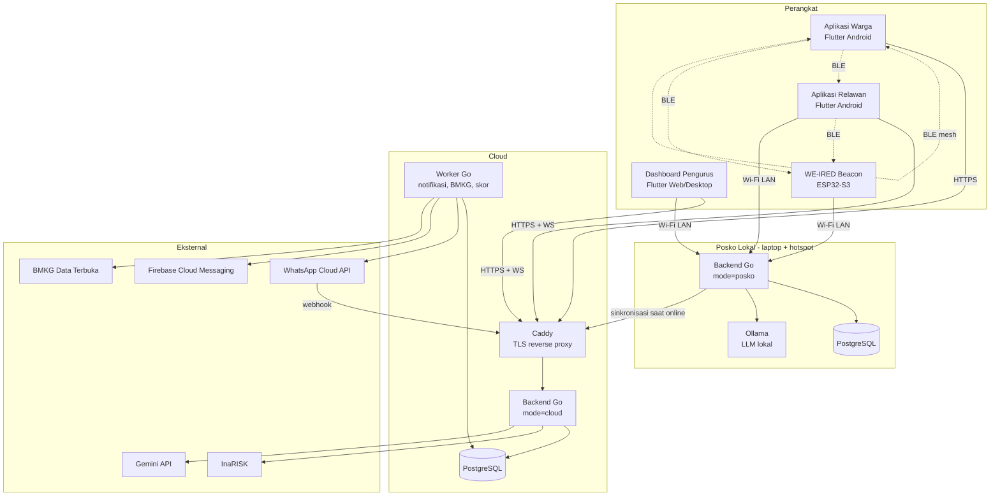
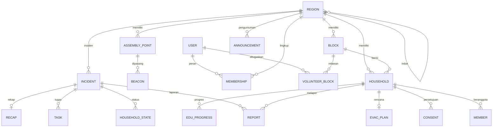
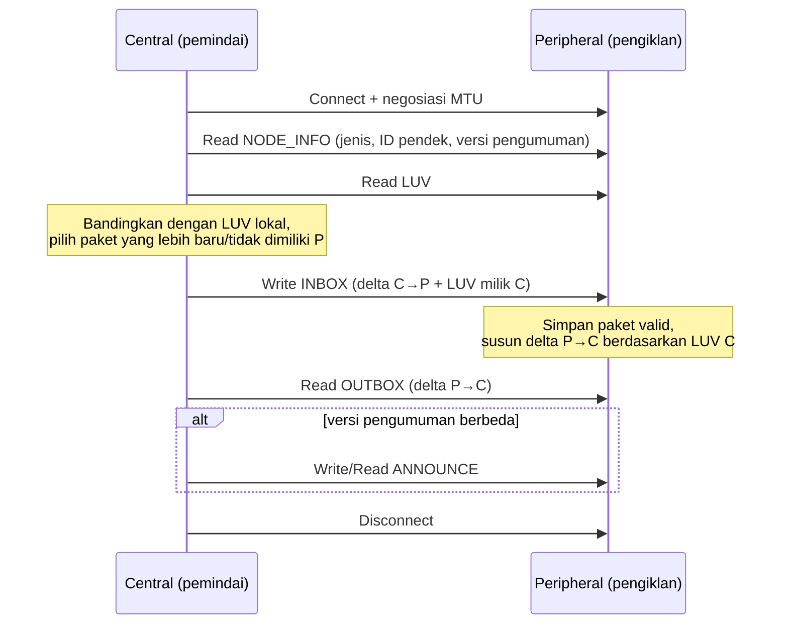
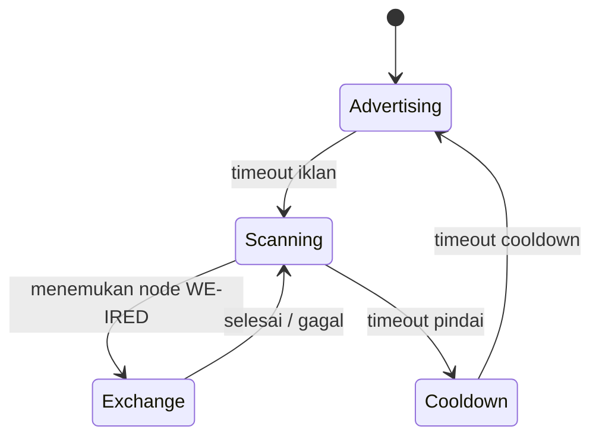
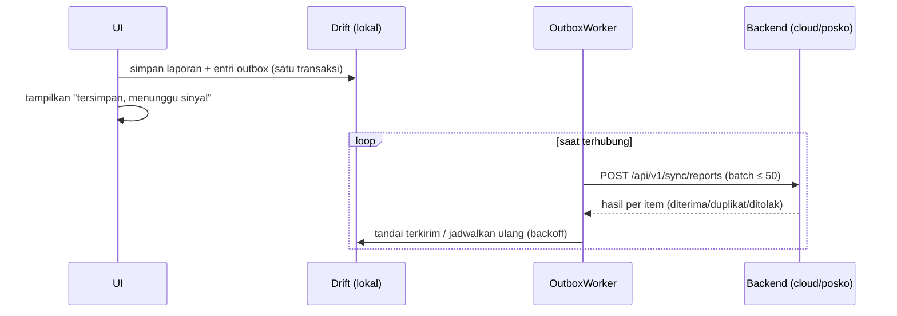
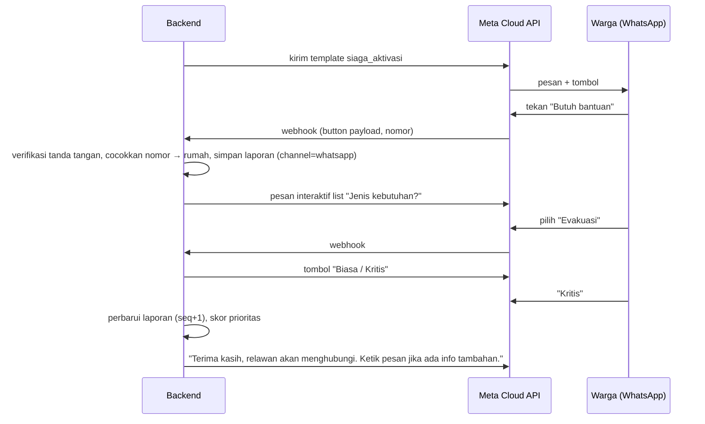

# Software Design Document (SDD) — WE-IRED

| Atribut | Keterangan |
|---|---|
| Produk | WE-IRED |
| Versi dokumen | 0.1 (draf) |
| Tanggal | 23 Oktober 2026 |
| Acuan | [PRD.md](PRD.md) · [SRS.md](SRS.md) |
| Dokumen terkait | [HRD.md](HRD.md) (perangkat keras & firmware WE-IRED Beacon) |

---

## 1. Pendahuluan

Dokumen ini menjelaskan rancangan teknis WE-IRED: arsitektur, teknologi, struktur modul, model data, algoritma inti, protokol Bluetooth, mekanisme sinkronisasi, API, integrasi eksternal, keamanan, dan deployment. Setiap bagian merujuk ke kebutuhan di SRS.

**Prinsip desain:**

1. **Offline-first.** Setiap perangkat menulis ke penyimpanan lokal lebih dulu, lalu menyinkronkan.
2. **Idempoten di semua jalur.** Laporan yang sama dapat datang dari banyak kanal (aplikasi, relawan, mesh, beacon, Posko) tanpa menimbulkan duplikat.
3. **Satu kode backend, dua mode.** Binary Go yang sama berjalan sebagai `cloud` atau `posko`.
4. **Data minimal di udara.** Paket Bluetooth hanya berisi data yang dibutuhkan untuk koordinasi, tanpa identitas atau data kesehatan.
5. **Server sebagai sumber kebenaran.** Status terkini rumah ditentukan oleh backend dengan aturan deterministik.

---

## 2. Arsitektur Sistem

### 2.1 Gambaran Umum



### 2.2 Lapisan Penyampaian Laporan

Laporan warga berpindah melalui lapisan berikut. Lapisan paling atas yang tersedia selalu dipakai lebih dulu, dan lapisan lain tetap berjalan paralel sebagai cadangan.

| Lapisan | Jalur | Syarat |
|---|---|---|
| 1 | Aplikasi → Backend cloud | Internet tersedia |
| 2 | WhatsApp → Backend cloud | Internet tersedia, tanpa aplikasi |
| 3 | Aplikasi → Posko Lokal | Terhubung ke hotspot Posko |
| 4 | Aplikasi → (mesh antar-HP) → HP Relawan → Backend/Posko | Bluetooth, relawan berpindah |
| 5 | Aplikasi → WE-IRED Beacon → Posko Lokal (Wi-Fi) | Warga di sekitar titik kumpul |
| 6 | Relawan mendatangi rumah → laporan atas nama warga | Tanpa perangkat warga |

### 2.3 Mode Backend

| Aspek | `cloud` | `posko` |
|---|---|---|
| Lokasi | VPS | Laptop di posko |
| Data | Seluruh wilayah | Snapshot satu atau beberapa RT |
| WhatsApp, FCM, BMKG | Aktif | Nonaktif (diantrikan ke cloud) |
| AI | Gemini (opsional) dan/atau Ollama | Ollama |
| Penerima beacon | Tidak (beacon tidak memiliki internet) | Ya |
| Sinkronisasi | Server | Klien terhadap cloud |

---

## 3. Teknologi

### 3.1 Aplikasi (Flutter)

| Kebutuhan | Pilihan |
|---|---|
| Bahasa / SDK | Dart 3, Flutter stable |
| Manajemen state | Riverpod |
| Navigasi | go_router |
| Basis data lokal | Drift (SQLite) |
| HTTP | dio |
| WebSocket | web_socket_channel |
| BLE central | flutter_blue_plus |
| BLE peripheral | ble_peripheral |
| Foreground service | flutter_foreground_task |
| Peta | flutter_map + latlong2, cache tile OSM (paket dipilih dengan memperhatikan lisensi) |
| Lokasi | geolocator |
| Baterai | battery_plus |
| Push | firebase_messaging (FCM saja) |
| Penyimpanan aman | flutter_secure_storage (Android Keystore) |
| Kriptografi | cryptography (HMAC-SHA256, Ed25519 verify) |
| QR | mobile_scanner |
| Monorepo | melos |

### 3.2 Backend (Go)

| Kebutuhan | Pilihan |
|---|---|
| Bahasa | Go 1.23+ |
| Router HTTP | chi |
| Basis data | PostgreSQL 16, driver pgx |
| Query | sqlc (query SQL bertipe) |
| Migrasi | golang-migrate |
| WebSocket | coder/websocket |
| Autentikasi | JWT (golang-jwt), Argon2id |
| Antrean pekerjaan | Tabel `jobs` di PostgreSQL (`FOR UPDATE SKIP LOCKED`) |
| PDF | maroto |
| Logging | log/slog (JSON) |
| Konfigurasi | variabel lingkungan + berkas `.env` (tidak di-commit) |
| Uji | testing, testify, testcontainers-go |

### 3.3 Firmware Beacon

| Kebutuhan | Pilihan |
|---|---|
| Platform | ESP32-S3, PlatformIO, framework Arduino-ESP32 |
| BLE | NimBLE-Arduino |
| Penyimpanan | LittleFS (flash internal) |
| RTC | RTClib (DS3231) |
| Layar | U8g2 (SSD1306) |
| Kriptografi | mbedTLS bawaan (HMAC-SHA256), pustaka Ed25519 untuk verifikasi pengumuman |

Detail perangkat keras ada di [HRD.md](HRD.md).

### 3.4 Infrastruktur

Docker & Docker Compose, Caddy (TLS otomatis), GitHub Actions (lint, uji, gitleaks, build APK).

---

## 4. Desain Komponen

### 4.1 Struktur Repositori

```
RESQUE-STACK-GDG/
├── apps/
│   ├── warga/              # Aplikasi Warga (Flutter Android)
│   ├── relawan/            # Aplikasi Relawan (Flutter Android)
│   └── dashboard/          # Dashboard Pengurus (Flutter Web + Windows)
├── packages/
│   ├── core/               # model, API client, outbox, Drift DB, auth
│   ├── ble_relay/          # codec paket, LUV, siklus peran, GATT
│   ├── ui/                 # design system, komponen aksesibel
│   └── content/            # P3K & edukasi bawaan (JSON + aset)
├── backend/
│   ├── cmd/weired/        # main: --mode=cloud|posko --role=api|worker|all
│   ├── internal/           # modul domain (lihat 4.2)
│   ├── db/migrations/      # berkas migrasi berversi
│   ├── db/queries/         # query sqlc
│   └── tools/seed/         # generator data sintetis
├── firmware/beacon/        # PlatformIO project
├── hardware/               # BOM aktual, wiring, casing, laporan uji beacon
├── deploy/
│   ├── docker-compose.cloud.yml
│   ├── docker-compose.posko.yml
│   └── Caddyfile
├── docs/                   # PRD, SRS, SDD, HRD
│   └── test-vectors/       # vektor uji protokol (Dart, Go, firmware)
├── Pembagian fitur.md      # pembagian tugas tim
└── README.md
```

### 4.2 Modul Backend

Setiap modul berisi `handler.go` (HTTP), `service.go` (logika), dan `store.go` (akses data via sqlc).

| Modul | Tanggung jawab | Kebutuhan |
|---|---|---|
| `auth` | OTP WhatsApp, login sandi, JWT, refresh token, RBAC middleware | FR-AUTH |
| `region` | Hierarki kelurahan/RW/RT, keanggotaan peran | FR-MRT |
| `household` | Rumah, anggota, persetujuan, impor CSV, kode undangan, kunci rumah | FR-HH |
| `assembly` | Titik kumpul, relasi blok–titik kumpul | FR-AP |
| `volunteer` | Blok, relawan, penugasan blok, ketersediaan | FR-VOL |
| `education` | Modul, kuis, progres, checklist, rencana evakuasi, skor kesiapsiagaan | FR-EDU |
| `incident` | Siklus insiden, mode latihan, metrik | FR-INC |
| `report` | Penerimaan laporan, resolusi status rumah | FR-RPT, FR-PRX |
| `priority` | Skor prioritas, rencana penugasan | FR-PRI, FR-TSK-01 |
| `task` | Penugasan relawan, status tugas | FR-TSK |
| `announcement` | Pengumuman, penandatanganan Ed25519 | FR-ANN |
| `relay` | Codec paket biner, verifikasi HMAC, metadata jalur | FR-BLE-03/04 |
| `sync` | Endpoint sinkronisasi aplikasi, snapshot, event log | FR-SYNC |
| `posko` | Snapshot, push/pull ke cloud, resolusi konflik | FR-PSK |
| `beacon` | Registrasi, provisioning, penerimaan sinkron beacon, telemetri | FR-BCN |
| `recap` | Penyusunan rekap, PDF/CSV | FR-RCP |
| `ai` | Antarmuka penyedia LLM, anonimisasi | FR-AI |
| `external/bmkg`, `external/inarisk` | Polling dan pencocokan wilayah | FR-EXT |
| `notify/fcm`, `notify/whatsapp` | Pengiriman notifikasi, webhook WhatsApp, sesi percakapan | FR-WA |
| `realtime` | Hub WebSocket per insiden | FR-DSH-02 |
| `audit` | Audit log | FR-ADM |
| `platform` | Konfigurasi, DB pool, kriptografi, antrean pekerjaan, rate limit | NFR |

### 4.3 Aplikasi Warga

| Layar | Isi |
|---|---|
| Aktivasi | Kode undangan → nomor WA → OTP |
| Beranda (normal) | Carousel pengumuman, skor kesiapsiagaan, pintasan edukasi, rencana evakuasi |
| Beranda (siaga) | Banner insiden (merah, atau kuning "LATIHAN"), 3 tombol lapor besar, status pengiriman, carousel pengumuman |
| Butuh Bantuan | Urgensi, kebutuhan, anggota, pesan singkat |
| Rumah Saya | Data anggota, persetujuan, unduh/hapus data |
| Edukasi | Modul, kuis, checklist tas siaga, rencana evakuasi |
| P3K | Panduan offline |
| Pengaturan | Mode baterai, check-in otomatis, izin Bluetooth/lokasi |

Layanan latar: `OutboxWorker`, `BleRelayService` (foreground saat siaga), `BeaconDetector`, `PushHandler`.

### 4.4 Aplikasi Relawan

| Layar | Isi |
|---|---|
| Tugas | Daftar tugas aktif berurutan sesuai prioritas, aksi status |
| Peta Blok | Rumah di blok, status, rute ke rumah |
| Lapor Atas Nama | Pilih rumah → status → anggota |
| Kolektor | Status pemindaian BLE, jumlah paket terkumpul, tombol sinkron |
| Node & Topologi | Daftar node sekitar, graf jalur relay |
| Posko | Pindai QR Posko, status koneksi |
| Beacon | Provisioning dan diagnostik beacon (khusus pengurus/relawan berizin) |
| P3K | Panduan offline |

### 4.5 Dashboard Pengurus

| Halaman | Isi |
|---|---|
| Ringkasan Insiden | Kartu status, waktu sejak aktivasi, metrik, banner BMKG |
| Peta | Pin rumah, titik kumpul, radius, beacon, relawan |
| Triase | Tabel triase + daftar Belum Melapor |
| Penugasan | Rencana yang disarankan, persetujuan, papan status tugas |
| Pengumuman | Editor 160 karakter, pilihan kanal |
| Data RT | Rumah, anggota, persetujuan, blok, relawan, titik kumpul, beacon, impor CSV |
| Edukasi | Konten modul/kuis, skor kesiapsiagaan per rumah/blok |
| Riwayat & Latihan | Insiden lalu, perbandingan metrik |
| Rekap | Pratinjau, catatan, draf AI, persetujuan, ekspor, kirim WA |
| Topologi | Graf relay dan node |
| Wilayah | Agregat multi-RT (Admin Wilayah) |
| Audit | Audit log |
| Posko | Snapshot, status sinkron cloud, QR konfigurasi relawan |

---

## 5. Desain Data

### 5.1 Diagram Entitas (ringkas)



### 5.2 Tabel Utama

**`regions`** — `id uuid`, `type` (kelurahan | rw | rt), `parent_id`, `name`, `code`, `centroid_lat`, `centroid_lon`, `ai_enabled bool`.

**`users`** — `id`, `name`, `phone` (unik, E.164), `email`, `password_hash`, `created_at`.

**`memberships`** — `user_id`, `region_id`, `role` (operator | admin_wilayah | pengurus | relawan | kepala_keluarga), `household_id` (untuk kepala keluarga).

**`blocks`** — `id`, `rt_id`, `name`, `polygon geojson` (opsional).

**`households`**

| Kolom | Tipe | Keterangan |
|---|---|---|
| id | uuid | |
| rt_id, block_id | uuid | |
| number, address | text | |
| lat, lon | double | Lokasi rumah |
| head_name | text | |
| wa_phone | text | Nomor WhatsApp kepala keluarga |
| has_device | bool | False → perlu dijangkau relawan |
| short_id | bytea(8) | ID pseudonim acak untuk paket relay |
| key_enc | bytea | Kunci rumah 32 byte, terenkripsi AES-256-GCM |
| invite_code | text | 8 karakter, sekali pakai |
| is_synthetic | bool | Data sintetis |

**`members`** — `id`, `household_id`, `idx smallint` (0–7, urutan untuk bitmask), `name`, `birth_year`, `sex`, `relation`, `vuln_flags int` (bit: 0 lansia, 1 disabilitas, 2 ibu hamil, 3 balita, 4 penyakit kronis), `health_notes_enc bytea`, `needs_evac_assist bool`.

**`consents`** — `id`, `household_id`, `given_by`, `method` (aplikasi | kertas | lisan_disaksikan), `text_version`, `given_at`, `revoked_at`.

**`assembly_points`** — `id`, `rt_id`, `name`, `lat`, `lon`, `capacity`, `facilities jsonb`, `contact`.

**`block_assembly_points`** — `block_id`, `assembly_point_id`, `rank` (1 utama, 2 cadangan).

**`volunteers`** — `user_id`, `rt_id`, `skills text[]`, `available bool`, `last_lat`, `last_lon`, `last_loc_at`.

**`volunteer_blocks`** — `user_id`, `block_id`.

**`beacons`** — `id`, `device_id` (MAC/ID chip), `assembly_point_id`, `name`, `secret_enc`, `fw_version`, `battery_pct`, `battery_mv`, `stored_packets`, `last_sync_at`.

**`incidents`** — `id`, `rt_id`, `short_id int` (uint32 untuk paket), `hazard` (banjir | longsor | gempa | kebakaran | lainnya), `mode` (nyata | latihan), `scope_block_ids uuid[]`, `message`, `started_by`, `started_at`, `ended_at`, `status` (aktif | selesai), `metrics jsonb`.

**`reports`**

| Kolom | Tipe | Keterangan |
|---|---|---|
| id | uuid | Dibuat perangkat (aplikasi) atau diturunkan deterministik dari paket relay |
| incident_id, household_id | uuid | |
| seq | int | Nomor urut per rumah per insiden |
| status | smallint | 1 aman, 2 titik kumpul, 3 butuh bantuan |
| urgency | smallint | 0 tidak ada, 1 biasa, 2 kritis |
| needs | smallint | Bitmask kebutuhan |
| member_mask | smallint | Bitmask anggota yang butuh bantuan / dikonfirmasi |
| message | text | Hanya dari kanal online/WA/outbox |
| lat, lon, battery | | Opsional |
| channel | text | app, outbox, relay_volunteer, mesh, beacon, beacon_checkin, whatsapp, proxy |
| reporter_user_id | uuid | Untuk laporan relawan |
| beacon_id | uuid | Untuk check-in beacon |
| device_time | timestamptz | Waktu di perangkat |
| received_at | timestamptz | Waktu diterima backend pertama kali |
| relay_path | jsonb | Daftar ID pendek node yang dilewati |
| | | **Unik:** `(incident_id, household_id, seq)` dan `id` |

**`household_states`** — `incident_id`, `household_id`, `report_id`, `status`, `urgency`, `needs`, `member_mask`, `priority_score`, `score_breakdown jsonb`, `reached bool`, `unconfirmed_vulnerable smallint`, `updated_at`.

**`tasks`** — `id`, `incident_id`, `household_id`, `volunteer_id`, `status` (disarankan | ditugaskan | diterima | dalam_perjalanan | dijangkau | selesai | ditolak), `outcome` (aman_di_tempat | dievakuasi | dirujuk | butuh_lanjutan), `reject_reason`, `created_by`, timestamp per status.

**`announcements`** — `id`, `region_ids uuid[]`, `incident_id`, `short_id int`, `level` (info | penting | darurat), `text varchar(160)`, `expires_at`, `signature bytea` (Ed25519), `channels text[]`.

**`notifications`** — `id`, `channel` (fcm | whatsapp), `recipient`, `template`, `payload jsonb`, `status` (antri | terkirim | diterima | dibaca | gagal), `provider_id`, `error`, timestamp.

**`wa_sessions`** — `phone`, `household_id`, `incident_id`, `state` (menunggu_kebutuhan | menunggu_urgensi | menunggu_pesan | selesai), `draft jsonb`, `expires_at`.

**Edukasi** — `edu_modules` (`id`, `hazard`, `title`, `content jsonb`, `version`, `published`), `edu_questions`, `edu_progress` (`household_id`, `module_id`, `completed_at`, `quiz_score`), `checklist_items`, `household_checklist`, `evac_plans` (`household_id`, `assembly_point_id`, `responsibilities jsonb`, `emergency_contacts jsonb`, `documents_location`).

**Lainnya** — `recaps` (`incident_id`, `data jsonb`, `narrative`, `ai_assisted`, `notes`, `approved_by`, `approved_at`, `pdf_url`), `ext_alerts` (`source`, `external_id`, `payload`, `matched_region_ids`), `audit_logs`, `devices` (token FCM), `refresh_tokens`, `otp_codes`, `jobs`, `events`.

**`events`** — log perubahan berurutan (`id bigserial`, `region_id`, `entity`, `entity_id`, `op`, `payload`, `origin` (cloud | posko:<id>), `created_at`). Dipakai sebagai kursor sinkronisasi Posko ↔ cloud dan sumber siaran WebSocket.

### 5.3 Basis Data Lokal Aplikasi (Drift)

| Tabel | Aplikasi | Isi |
|---|---|---|
| `session` | Semua | Token, peran, ID rumah/relawan |
| `household_snapshot` | Warga, Relawan | Data rumah (warga: rumahnya; relawan: rumah di blok) |
| `outbox` | Semua | `id`, `kind`, `payload`, `created_at`, `attempts`, `next_attempt_at`, `status` |
| `relay_packets` | Warga, Relawan | `key (household_short_id, incident_short_id, seq)`, `bytes`, `received_from`, `received_at`, `acked bool` |
| `announcements` | Warga, Relawan | Pengumuman terverifikasi |
| `beacons_known` | Warga | ID beacon → titik kumpul |
| `content_cache` | Warga | Modul edukasi yang diunduh |

---

## 6. Algoritma Inti

### 6.1 Skor Prioritas (FR-PRI-01)

```
Skor = min(100, U + V + W + N + D)
```

| Komponen | Aturan | Maks. |
|---|---|---|
| **U** — Status & urgensi | Butuh bantuan kritis = 40 · Butuh bantuan biasa = 28 · Belum melapor = 22 · Aman di rumah dengan kebutuhan = 10 · Di titik kumpul dengan anggota rentan belum terkonfirmasi = 8 · Aman tanpa kebutuhan / di titik kumpul lengkap = 0 (keluar dari antrean) | 40 |
| **V** — Kerentanan | 8 × jumlah anggota rentan yang belum terkonfirmasi aman | 24 |
| **W** — Lama menunggu | 0,25 × menit sejak aktivasi (belum melapor) atau sejak laporan "butuh bantuan" terakhir | 20 |
| **N** — Kebutuhan | Evakuasi 6, Medis 6, Makanan & air 2, Tempat tinggal 2, Lainnya 1 (dijumlahkan) | 10 |
| **D** — Jarak | 6 × min(1, jarak rumah ke titik kumpul terdekat / 500 m). Rumah yang lebih jauh lebih sulit mengevakuasi diri sendiri | 6 |

**Aturan tambahan:**
- Rumah dengan tugas berstatus `dijangkau` atau `selesai` keluar dari antrean sampai ada laporan "butuh bantuan" baru.
- Urutan jika skor sama: V lebih tinggi → menunggu lebih lama → jarak lebih jauh.
- Rincian `score_breakdown` disimpan untuk ditampilkan di dashboard (FR-PRI-04).

**Contoh:** rumah belum melapor 40 menit, 2 lansia, 300 m dari titik kumpul:
U = 22, V = 16, W = 10, N = 0, D = 3,6 → **Skor 51,6**.
Rumah butuh bantuan kritis (medis + evakuasi), 1 balita, laporan 10 menit lalu, 100 m:
U = 40, V = 8, W = 2,5, N = 10 (dibatasi), D = 1,2 → **Skor 61,7**.

### 6.2 Resolusi Status Rumah (FR-RPT-06)

```
fungsi terapkan(laporan):
    jika reports berisi laporan.id atau (incident, household, seq) → kembalikan "sudah ada" (idempoten)
    simpan laporan
    state = household_states[incident, household]
    jika state kosong → state = laporan
    jika tidak:
        jika laporan.seq > state.seq:
            jika state = butuh_bantuan KRITIS
               dan laporan.channel = beacon_checkin
               dan belum ada konfirmasi warga/relawan:
                   catat laporan, tandai "perlu konfirmasi", jangan ganti status
            jika tidak → state = laporan
        jika laporan.seq == state.seq dan laporan.received_at < state.received_at → state = laporan
    hitung ulang skor prioritas → siarkan event household.status_changed
```

Nomor urut (`seq`) dibuat perangkat warga dan selalu naik. Laporan relawan atas nama warga dan laporan WhatsApp memakai urutan server: `seq = max(seq tercatat) + 1`. Laporan WhatsApp diterima langsung oleh server cloud, sehingga urutannya konsisten.

### 6.3 Rencana Penugasan (FR-TSK-01)

Algoritma greedy yang dijalankan setiap 60 detik atau saat diminta:

```
antrean = rumah dalam insiden, skor > 0, tanpa tugas aktif, urut skor menurun
relawan = relawan tersedia, beban aktif < 2 tugas
untuk setiap rumah di antrean:
    kandidat = relawan dengan blok = blok rumah
    jika kosong → kandidat = semua relawan tersedia
    pilih kandidat dengan (beban terkecil, jarak terdekat)
       jarak = haversine(lokasi terakhir relawan atau pusat bloknya, rumah)
    buat tugas berstatus "disarankan"
```

Pengurus menyetujui (berubah menjadi `ditugaskan` dan relawan diberi notifikasi) atau mengubah saran. Tugas `ditugaskan` yang tidak diterima dalam 5 menit diberi tanda (FR-TSK-05).

### 6.4 Skor Kesiapsiagaan (FR-EDU-05)

```
Skor = 30 × (modul selesai / modul wajib)
     + 30 × (rata-rata nilai kuis / 100)
     + 20 × (item checklist tercentang / total item)
     + 20 × (kelengkapan rencana evakuasi: titik kumpul, penanggung jawab
              tiap anggota rentan, ≥ 1 kontak darurat, lokasi dokumen → 4 syarat)
```

### 6.5 Metrik Insiden (FR-INC-07)

| Metrik | Perhitungan |
|---|---|
| `t90`, `t100` | Selisih waktu aktivasi dengan `received_at` pertama saat 90% / 100% rumah dalam cakupan memiliki status |
| `vuln_reached_30` | Rumah dengan warga rentan yang memiliki status aman/titik kumpul atau tugas `dijangkau` ≤ 30 menit ÷ total rumah dengan warga rentan |
| `by_channel` | Jumlah laporan per kanal |
| `offline_delivery` | Laporan yang dibuat saat offline dan sampai ke backend ÷ laporan offline yang tercatat dibuat (berdasarkan `seq` yang diterima) |
| `t_recap` | Waktu akhir insiden → rekap disetujui |

---

## 7. Protokol Bluetooth (BLE)

### 7.1 Identitas Layanan

| Elemen | UUID |
|---|---|
| Layanan WE-IRED (HP) | `5a1e0001-6c2b-4e8a-9f3d-2b6c8e4a1d00` |
| Karakteristik `NODE_INFO` (read) | `5a1e0002-6c2b-4e8a-9f3d-2b6c8e4a1d00` |
| Karakteristik `LUV` (read) | `5a1e0003-6c2b-4e8a-9f3d-2b6c8e4a1d00` |
| Karakteristik `INBOX` (write) | `5a1e0004-6c2b-4e8a-9f3d-2b6c8e4a1d00` |
| Karakteristik `OUTBOX` (read, notify) | `5a1e0005-6c2b-4e8a-9f3d-2b6c8e4a1d00` |
| Karakteristik `ANNOUNCE` (read, write) | `5a1e0006-6c2b-4e8a-9f3d-2b6c8e4a1d00` |
| Layanan WE-IRED Beacon | `5a1e0100-6c2b-4e8a-9f3d-2b6c8e4a1d00` |
| Karakteristik `BEACON_PROVISION` (write, terautentikasi) | `5a1e0101-6c2b-4e8a-9f3d-2b6c8e4a1d00` |
| Karakteristik `BEACON_STATUS` (read) | `5a1e0102-6c2b-4e8a-9f3d-2b6c8e4a1d00` |

Beacon juga menyediakan karakteristik `NODE_INFO`, `LUV`, `INBOX`, `OUTBOX`, dan `ANNOUNCE` di bawah layanan beacon dengan format yang sama.

**Data iklan (manufacturer data, 12 byte):** `jenis_node (1: warga, 2: relawan, 3: beacon)`, `rt_short_id (4)`, `incident_short_id (4)`, `announce_version (2)`, `flags (1: bit0 punya paket tertunda, bit1 baterai rendah)`. Beacon menambahkan `assembly_point_short_id (2)` melalui scan response.

### 7.2 Format Paket Laporan Relay (FR-BLE-03/04)

Biner, *little-endian*, panjang tetap 46 byte ditambah metadata jalur opsional.

| Offset | Ukuran | Field | Keterangan |
|---|---|---|---|
| 0 | 1 | `version` | `0x01` |
| 1 | 1 | `type` | `0x01` laporan status |
| 2 | 8 | `household_short_id` | ID pseudonim |
| 10 | 4 | `incident_short_id` | uint32 |
| 14 | 4 | `seq` | uint32 |
| 18 | 4 | `created_at` | Unix detik |
| 22 | 1 | `status` | 1 aman, 2 titik kumpul, 3 butuh bantuan |
| 23 | 1 | `urgency` | 0, 1, 2 |
| 24 | 1 | `needs` | bit0 evakuasi, bit1 medis, bit2 makanan & air, bit3 tempat tinggal, bit4 lainnya |
| 25 | 1 | `member_mask` | Bitmask indeks anggota (0–7) |
| 26 | 1 | `battery` | 0–100, 255 = tidak diketahui |
| 27 | 1 | `flags` | bit0 ada lokasi, bit1 latihan, bit2 check-in beacon |
| 28 | 4 | `lat_e6` | int32, derajat × 10⁶ (0 jika tidak ada) |
| 32 | 4 | `lon_e6` | int32 |
| 36 | 1 | `ttl` | Awal 6, dikurangi setiap lompatan (tidak ditandatangani) |
| 37 | 1 | `hop_count` | Bertambah setiap lompatan (tidak ditandatangani) |
| 38 | 8 | `mac` | HMAC-SHA256(kunci_rumah, byte 0–35), 8 byte pertama |
| 46 | 0–12 | `path` | Hingga 6 × ID node pendek (2 byte), tidak ditandatangani, untuk topologi |

- Pesan teks bebas **tidak** ikut dalam paket relay (privasi dan ukuran). Pesan dikirim saat online/WA.
- `id` laporan di backend = UUIDv5(namespace WE-IRED, `household_short_id ‖ incident_short_id ‖ seq`), sehingga paket yang sama dari banyak jalur menjadi satu laporan.
- Untuk check-in beacon, `flags` bit2 diset. ID beacon tidak disimpan di paket. Backend mengetahuinya dari header `X-Beacon-Id` saat paket diterima langsung oleh beacon (lihat 8.4), atau dari kolom `beacon_id` pada laporan JSON yang dikirim aplikasi melalui outbox.

### 7.3 Pembingkaian (Framing)

Payload GATT dibagi menjadi frame sesuai MTU yang dinegosiasikan (target 247 byte):

```
[msg_id:1][frame_idx:1][frame_total:1][payload...]
```

Satu pesan logis (misalnya daftar LUV atau kumpulan paket) dapat terdiri dari beberapa frame. Penerima merakit ulang berdasarkan `msg_id`.

### 7.4 Protokol Pertukaran LUV (FR-BLE-05)

**LUV** = daftar entri `(household_short_id 8B, incident_short_id 4B, seq 4B)` untuk paket terbaru yang dimiliki node (16 byte per entri).



**Aturan:**
- Paket dengan `ttl = 0` disimpan tetapi tidak diteruskan ke HP warga lain. Paket tetap boleh diserahkan ke relawan atau beacon, karena keduanya adalah tujuan akhir.
- Relawan dan beacon selalu menerima semua paket. HP warga menerima paket rumah lain hingga kuota 500 (FR-BLE-07).
- Node tidak memverifikasi HMAC (tidak memiliki kunci rumah lain). Verifikasi dilakukan backend. Node hanya memeriksa format dan panjang.
- Satu sesi dibatasi 5 detik (NFR-PERF-04). Jika delta lebih besar, paket diprioritaskan: status 3 kritis → status 3 → status lain, lalu yang terbaru.
- Setelah relawan menyinkronkan paket ke backend, ACK (daftar kunci paket) disebarkan kembali melalui `ANNOUNCE`/`INBOX` agar node lain dapat menandai `acked` dan menghapusnya (FR-BLE-12).

### 7.5 Siklus Peran (FR-BLE-10)



| Mode | Advertising | Scanning | Cooldown |
|---|---|---|---|
| Normal | 8 s | 4 s | 30 s |
| Hemat (baterai < 20% atau manual) | 4 s | 2 s | 90 s |
| Relawan (kolektor) | — | Terus-menerus (jeda 1 s per 10 s) | — |

Untuk menghindari koneksi berulang, node mengingat peer yang sudah ditukar dan versi LUV-nya selama 60 detik. Koneksi ulang hanya dilakukan jika flag "punya paket tertunda" berubah.

### 7.6 Pengumuman Bertanda Tangan (FR-ANN-04)

```
[version 1][type 0x10][rt_short_id 4][ann_short_id 4][level 1]
[created_at 4][expires_at 4][len 1][text ≤ 200 byte UTF-8][sig Ed25519 64]
```

Format yang sama dengan `type 0x11` dipakai untuk **pemberitahuan insiden** (mulai/selesai, `incident_short_id`, mode nyata/latihan). Hanya pemberitahuan ini yang dapat memindahkan beacon ke mode SIAGA (lihat HRD 7.2).

Kunci publik server dibagikan saat aktivasi aplikasi dan provisioning beacon. Perangkat hanya menampilkan dan meneruskan pengumuman dengan tanda tangan valid. `announce_version` di data iklan = `ann_short_id` terbaru (16 bit bawah).

### 7.7 Check-in Beacon (FR-BCN-05)

1. `BeaconDetector` memindai iklan beacon (jenis node 3) dengan `rt_short_id` yang sesuai.
2. RSSI dihaluskan dengan *moving average* 5 sampel. Jika ≥ ambang RSSI beacon tersebut (bawaan −75 dBm, hasil kalibrasi dari snapshot) selama ≥ 10 detik, aplikasi menampilkan notifikasi "Anda berada di titik kumpul X. Laporkan sudah sampai?".
3. Setelah dikonfirmasi (atau otomatis jika opsi diaktifkan), aplikasi membuat laporan status 2 dengan flag check-in, mengirimnya ke beacon melalui `INBOX` dan ke outbox.
4. Ambang RSSI dikalibrasi per lokasi saat instalasi (lihat HRD Bagian 9).

---

## 8. Sinkronisasi

### 8.1 Outbox Aplikasi (FR-SYNC-01/02)



`OutboxWorker` memeriksa endpoint secara berurutan: cloud (`https://api.we-ired.id`, contoh) → Posko terkonfigurasi (`http://weired-posko.local:8080` atau IP dari QR). Endpoint pertama yang merespons `/healthz` dalam 3 detik dipakai.

### 8.2 Snapshot Posko (FR-PSK-02)

`POST /api/v1/posko/snapshot` (cloud, peran pengurus) menghasilkan paket terenkripsi berisi data master RT, kunci rumah (untuk verifikasi HMAC), rahasia beacon, kunci publik pengumuman, dan kursor `events` terakhir. Posko mengimpornya ke basis data lokal. Snapshot dienkripsi dengan kata sandi yang dimasukkan pengurus saat impor.

### 8.3 Posko ↔ Cloud (FR-PSK-05/06)

- **Push:** Posko mengirim `events` miliknya (`origin = posko:<id>`) sejak kursor terakhir yang diakui cloud ke `POST /api/v1/posko/push`. Cloud menerapkan setiap event secara idempoten (laporan memakai aturan 6.2).
- **Pull:** Posko mengambil `GET /api/v1/posko/pull?cursor=<n>` untuk perubahan dari cloud (misalnya laporan WhatsApp).
- **Konflik data master** (rumah/anggota diubah di dua tempat): versi cloud dipertahankan, versi Posko dicatat di `sync_conflicts` untuk ditinjau pengurus.
- Pekerjaan yang membutuhkan internet (WhatsApp, FCM) yang dibuat di Posko diantrikan dan dijalankan cloud setelah push.

### 8.4 Beacon ↔ Posko (FR-BCN-07)

`POST /api/v1/beacon/sync` dengan header:

```
X-Beacon-Id: <device_id>
X-Timestamp: <unix detik>
X-Signature: hex(HMAC-SHA256(rahasia_beacon, timestamp ‖ "\n" ‖ body))
Content-Type: application/octet-stream
```

Body: `[jumlah:2]` lalu `n` entri `[panjang:1][paket relay 46–58 byte][langsung:1]`, diakhiri `[telemetri 16 byte]`. `langsung = 1` berarti paket diterima beacon langsung dari HP pembuatnya (`hop_count = 0`). Untuk paket check-in seperti itu, backend mengisi `beacon_id` laporan dari header `X-Beacon-Id`.

Respons: `[waktu_server:4][jumlah_ack:2][kunci paket × n][pengumuman terbaru bertanda tangan (opsional)]`. Beacon menghapus paket yang di-ACK dan memperbarui RTC.

Backend menolak permintaan dengan selisih `X-Timestamp` > 300 detik dari waktu server, kecuali permintaan pertama setelah boot yang ditandai flag "RTC belum sinkron" (dibatasi rate).

---

## 9. API

Semua endpoint berprefiks `/api/v1`, berformat JSON (kecuali disebutkan), dan memakai `Authorization: Bearer <jwt>`.

### 9.1 Autentikasi
| Metode | Endpoint | Keterangan |
|---|---|---|
| POST | `/auth/otp/request` | Kirim OTP via WhatsApp |
| POST | `/auth/otp/verify` | Verifikasi OTP → token |
| POST | `/auth/login` | Email + sandi (dashboard) |
| POST | `/auth/activate` | Kode undangan + OTP → akun kepala keluarga + kunci rumah |
| POST | `/auth/refresh` · `/auth/logout` | |

### 9.2 Data RT
| Metode | Endpoint |
|---|---|
| GET/POST | `/rts/{rt}/households` · `/rts/{rt}/households/import` (CSV) |
| GET/PATCH/DELETE | `/households/{id}` |
| GET/POST/PATCH/DELETE | `/households/{id}/members[/{mid}]` |
| POST/DELETE | `/households/{id}/consent` |
| POST | `/households/{id}/invite` (buat ulang & kirim kode) |
| GET | `/households/{id}/export` (hak akses data) |
| CRUD | `/rts/{rt}/blocks`, `/rts/{rt}/assembly-points`, `/rts/{rt}/volunteers`, `/rts/{rt}/beacons` |
| POST | `/beacons/{id}/provision-token` (token sekali pakai untuk provisioning via aplikasi) |

### 9.3 Insiden & Operasi
| Metode | Endpoint | Keterangan |
|---|---|---|
| POST | `/rts/{rt}/incidents` | Aktivasi (nyata/latihan) |
| POST | `/incidents/{id}/end` | Akhiri |
| GET | `/incidents/{id}` · `/incidents/{id}/summary` · `/incidents/{id}/metrics` | |
| GET | `/incidents/{id}/households?status=&block=&sort=priority` | Tabel triase |
| GET | `/incidents/{id}/unreported` | Belum melapor |
| POST | `/incidents/{id}/reports` | Laporan tunggal (aplikasi/relawan) |
| GET | `/incidents/{id}/plan` · POST `/incidents/{id}/plan/apply` | Rencana penugasan |
| CRUD | `/incidents/{id}/tasks` · PATCH `/tasks/{id}` | Status tugas |
| POST | `/announcements` · GET `/rts/{rt}/announcements` | |
| GET | `/incidents/{id}/topology` | Graf relay |

### 9.4 Sinkronisasi
| Metode | Endpoint | Keterangan |
|---|---|---|
| GET | `/healthz` | Deteksi endpoint |
| POST | `/sync/reports` | Batch laporan JSON dari outbox |
| POST | `/sync/relay-packets` | Batch paket biner (base64) dari relawan, dengan `path` dan `collector_id` |
| GET | `/sync/snapshot?scope=household|volunteer` | Snapshot data lokal aplikasi |
| GET | `/sync/acks?incident=` | Daftar kunci paket yang sudah diterima (untuk ACK relay) |
| POST | `/posko/snapshot` · `/posko/push` · GET `/posko/pull` | Posko ↔ cloud |
| POST | `/beacon/sync` | Biner, lihat 8.4 |

### 9.5 Edukasi, Rekap, Integrasi
| Metode | Endpoint |
|---|---|
| GET | `/edu/modules` · `/edu/modules/{id}` |
| POST | `/edu/progress` · PUT `/households/{id}/checklist` · PUT `/households/{id}/evac-plan` |
| GET | `/rts/{rt}/readiness` |
| POST | `/incidents/{id}/recap` (susun) · PATCH `/recaps/{id}` · POST `/recaps/{id}/approve` |
| GET | `/recaps/{id}.pdf` · `/recaps/{id}.csv` · POST `/recaps/{id}/send-whatsapp` |
| POST | `/ai/summarize-messages` · `/ai/classify-needs` · `/ai/draft-recap` |
| GET | `/rts/{rt}/external-alerts` · `/rts/{rt}/risk` (InaRISK) |
| GET | `/regions/{id}/aggregate` (Admin Wilayah) |
| GET | `/rts/{rt}/audit-logs` |
| GET/POST | `/webhooks/whatsapp` (verifikasi & penerimaan, tanpa JWT, dengan verifikasi tanda tangan Meta) |

### 9.6 WebSocket

`GET /ws?incident={id}` (JWT via query/subprotokol). Pesan dari server:

| Event | Payload |
|---|---|
| `incident.updated` | status, metrik ringkas |
| `household.status_changed` | household_id, status, urgency, needs, channel, priority_score |
| `priority.recomputed` | daftar (household_id, skor) yang berubah |
| `task.updated` | task |
| `announcement.created` | pengumuman |
| `beacon.telemetry` | beacon_id, baterai, paket, last_sync |
| `ext_alert.matched` | ringkasan BMKG |

Klien memakai `last_event_id` saat menyambung ulang untuk mengambil event yang terlewat.

### 9.7 Format Galat

```json
{ "error": { "code": "VALIDATION_FAILED", "message": "Nomor WhatsApp tidak valid", "details": {"field": "wa_phone"} } }
```

---

## 10. Integrasi Eksternal

### 10.1 WhatsApp Cloud API (FR-WA)

**Template (diajukan ke Meta):**

| Nama | Kategori | Isi ringkas | Komponen |
|---|---|---|---|
| `otp_login` | Authentication | Kode verifikasi WE-IRED | Tombol salin kode |
| `siaga_aktivasi` | Utility | "[SIAGA/LATIHAN] {jenis} di {RT}. Laporkan kondisi rumah Anda." | 3 tombol balasan cepat |
| `siaga_pengingat` | Utility | "Rumah Anda belum melapor…" | 3 tombol balasan cepat |
| `pengumuman_rt` | Utility | "{level}: {teks}" | — |
| `rekap_insiden` | Utility | "Rekap insiden {RT} {tanggal}" | Header dokumen PDF |

**Payload tombol:** `RPT|{incident_short_id}|{status}`.



Pesan lanjutan non-template dikirim dalam jendela layanan 24 jam setelah warga membalas. Status pengiriman dari webhook disimpan di `notifications`. Pengingat dijadwalkan sebagai `jobs` pada T+10 dan T+25 menit (FR-WA-05).

### 10.2 FCM

Topik per RT (`rt_{id}`) untuk aktivasi/pengumuman, dan token per perangkat untuk penugasan relawan. Payload berprioritas tinggi berisi `incident_id`, lalu aplikasi membuka layar lapor.

### 10.3 BMKG & InaRISK (FR-EXT)

- Worker mengambil data gempa terkini dari layanan data terbuka BMKG (misalnya berkas JSON `autogempa`/`gempaterkini`) dan feed peringatan dini cuaca setiap 5 menit. Endpoint persisnya dikonfirmasi saat implementasi.
- **Pencocokan gempa:** magnitudo ≥ 5,0 dan jarak episentrum ≤ 150 km dari pusat RT, atau nama kabupaten/kota RT ada di daftar wilayah "dirasakan".
- **Pencocokan cuaca:** kode/nama wilayah administratif peringatan mencakup kecamatan/kabupaten RT.
- Hasil yang cocok disimpan di `ext_alerts` dan disiarkan sebagai `ext_alert.matched`. Tidak ada aktivasi otomatis.
- InaRISK: dashboard menampilkan informasi/tautan risiko wilayah. Integrasi data dilakukan bila akses layanan tersedia.

### 10.4 Asisten AI (FR-AI)

```go
type LLMProvider interface {
    Summarize(ctx context.Context, msgs []AnonMessage) (Summary, error)
    ClassifyNeeds(ctx context.Context, text string) (NeedsSuggestion, error)
    DraftRecap(ctx context.Context, data RecapAggregate) (string, error)
}
```

| Penyedia | Mode | Konfigurasi |
|---|---|---|
| `ollama` | Posko/cloud | `OLLAMA_URL`, `OLLAMA_MODEL` (model kecil terkuantisasi, misalnya keluarga Qwen2.5 3B) |
| `gemini` | Cloud, jika `ai_enabled` dan diizinkan pengurus | `GEMINI_API_KEY`, `GEMINI_MODEL` |

**Anonimisasi:** nama diganti token (`[WARGA_1]`), nomor telepon dan alamat dihapus, nomor rumah diganti kode blok. Data kesehatan individu tidak pernah dikirim. Keluaran disimpan dengan flag `ai_assisted` dan ditampilkan dengan label peringatan (FR-AI-06).

---

## 11. Keamanan & Privasi

| Aspek | Desain |
|---|---|
| Transport | HTTPS (Caddy) di cloud. Posko: HTTPS dengan sertifikat self-signed yang sidik jarinya ada di QR konfigurasi (di-pin oleh aplikasi relawan) |
| Autentikasi | OTP WhatsApp / sandi Argon2id, JWT 15 menit, refresh token 30 hari (rotasi, dapat dicabut) |
| Otorisasi | Middleware RBAC + pemeriksaan lingkup (RT, blok, rumah) di layer service |
| Enkripsi data | `health_notes_enc`, `key_enc`, `secret_enc` dengan AES-256-GCM; kunci utama dari variabel lingkungan `DATA_KEY` |
| Integritas relay | HMAC-SHA256 per rumah (8 byte) + seq anti-replay |
| Integritas pengumuman | Ed25519 (kunci privat hanya di cloud; Posko memiliki kunci turunan yang ditandatangani cloud untuk pengumuman saat offline) |
| Beacon | Rahasia per beacon, permintaan bertanda tangan + timestamp; provisioning BLE butuh token sekali pakai dari dashboard |
| Minimisasi | Paket udara tanpa identitas/kesehatan; relawan hanya melihat bloknya |
| Audit | `audit_logs` untuk akses data rentan, ekspor, insiden |
| Rahasia | `.env` tidak di-commit; gitleaks di CI |
| Rate limit | Token bucket per IP & per pengguna; OTP 5 per 15 menit |
| Retensi | Cache relay 72 jam; laporan 2 tahun lalu dianonimkan; pencabutan persetujuan menghapus data kerentanan ≤ 24 jam |

---

## 12. Deployment

### 12.1 Cloud

```yaml
# deploy/docker-compose.cloud.yml (ringkas)
services:
  caddy:    { image: caddy:2, ports: ["80:80", "443:443"] }
  api:      { image: weired/backend, command: ["--mode=cloud", "--role=api"] }
  worker:   { image: weired/backend, command: ["--mode=cloud", "--role=worker"] }
  postgres: { image: postgres:16, volumes: ["pgdata:/var/lib/postgresql/data"] }
```

Dashboard Web dibangun (`flutter build web`) dan disajikan Caddy. Cadangan `pg_dump` harian.

### 12.2 Posko Lokal

```yaml
# deploy/docker-compose.posko.yml (ringkas)
services:
  api:      { image: weired/backend, command: ["--mode=posko", "--role=all"], ports: ["8080:8080"] }
  postgres: { image: postgres:16 }
  ollama:   { image: ollama/ollama, profiles: ["ai"] }
```

Langkah operasional: (1) impor snapshot, (2) aktifkan hotspot laptop (atau router portabel) dengan SSID yang sama seperti konfigurasi beacon, (3) tampilkan QR konfigurasi untuk relawan, (4) beacon terhubung otomatis. Alamat mDNS: `weired-posko.local`.

### 12.3 Aplikasi

APK dibangun per ABI melalui CI (`flutter build apk --split-per-abi`). Distribusi untuk uji/demo melalui tautan unduhan langsung. Build Windows untuk Dashboard Posko.

---

## 13. Strategi Pengujian

| Tingkat | Cakupan | Alat |
|---|---|---|
| Unit | Skor prioritas, resolusi status, codec paket, HMAC, LUV diff, skor kesiapsiagaan, anonimisasi | `go test`, `flutter test` |
| Integrasi | Endpoint API + PostgreSQL, idempotensi sync, posko push/pull, webhook WhatsApp (payload contoh) | testcontainers-go |
| Kontrak | Kecocokan codec paket Dart ↔ Go ↔ firmware C++ (vektor uji bersama di `docs/test-vectors/`) | Berkas vektor JSON |
| Perangkat | Pertukaran BLE 2–5 HP, jangkauan & RSSI beacon, konsumsi baterai | Uji lapangan terdokumentasi |
| Beban | 300 laporan/menit per RT, 50 RT | k6 |
| End-to-end | Skenario AC-01 s.d. AC-11 di SRS | Skrip skenario + data sintetis |
| Usabilitas | ≥ 5 pengguna (termasuk lansia) melapor tanpa pelatihan | Uji moderasi |

---

## 14. Observabilitas

- Log JSON terstruktur (`slog`) dengan `request_id`, `incident_id`, `channel`.
- Endpoint `/metrics` (format Prometheus): jumlah laporan per kanal, latensi API, antrean `jobs`, kegagalan WhatsApp, koneksi WebSocket.
- Dashboard menampilkan kesehatan sistem: status koneksi cloud/Posko, antrean notifikasi, beacon yang tidak sinkron > 5 menit.

---

## 15. Keputusan Desain Utama

| Keputusan | Alternatif | Alasan |
|---|---|---|
| Go + PostgreSQL | Firebase, Node.js | Satu binary untuk cloud & Posko, efisien untuk lonjakan koneksi, kontrol penuh data sensitif |
| Flutter untuk 3 aplikasi | PWA | Akses BLE peripheral/central, foreground service, satu codebase |
| Drift (SQLite) di perangkat | Hive | Kebutuhan kueri relasional (outbox, snapshot blok) |
| Paket biner 46 byte | JSON | Muat dalam satu frame BLE, hemat waktu kontak |
| HMAC per rumah | Tanpa tanda tangan | Mencegah laporan palsu lewat relay tanpa memberi node kemampuan membaca/memalsukan |
| Ed25519 untuk pengumuman | HMAC bersama | Perangkat cukup memegang kunci publik |
| WhatsApp Cloud API resmi | Library tidak resmi | Legal, stabil, mendukung tombol interaktif |
| Skor prioritas berbasis aturan | Model ML | Transparan, dapat dijelaskan, berjalan offline |
| AI hanya sebagai saran | Otomasi penuh | Keputusan darurat harus oleh manusia; memenuhi aturan STACK tentang tanggung jawab tim |
